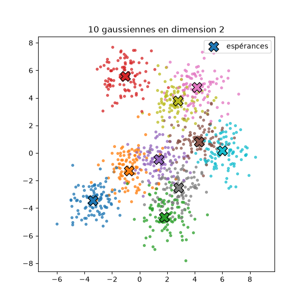
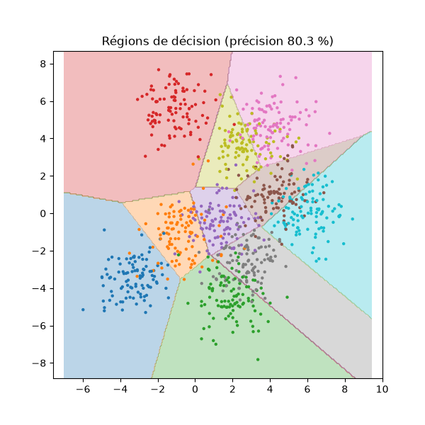
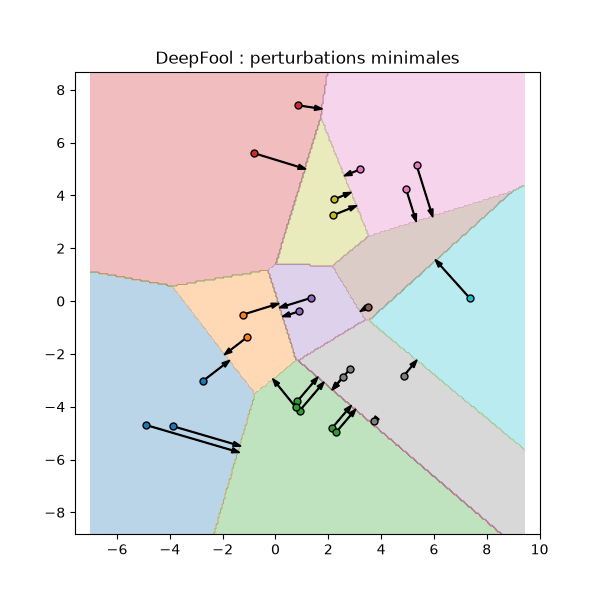
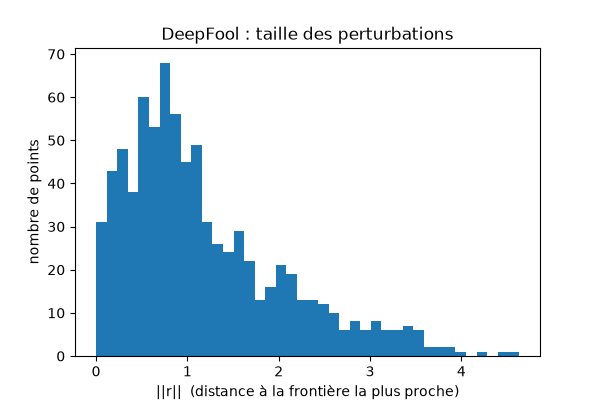
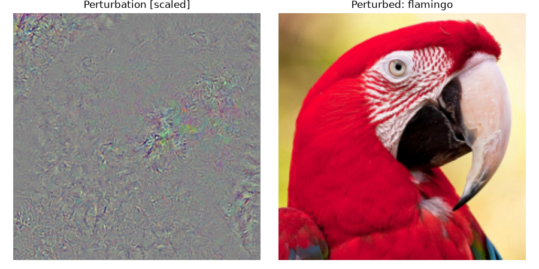

# Tests de DeepFool

Deux tests pour comprendre et vérifier [`deepfool.py`](../deepfool.py), la brique de base de la perturbation universelle.

```bash
python testlogistic/logistic_model.py   # données et régions de décision
python testlogistic/testlogistic.py     # DeepFool sur la régression logistique
python testlogistic/test_deepfool.py    # DeepFool sur resnet34, une image ImageNet
```
Les scripts se lancent depuis n'importe quel dossier. Les résultats (chiffres et figures) sont enregistrés dans [results/](results/).

## 1. Régression logistique en 2D (`logistic_model.py`, `testlogistic.py`)

**Données.** 10 gaussiennes en dimension 2 (covariance identité, 100 points chacune), aux espérances proches, donc qui se chevauchent.
**Modèle.** Une régression logistique (`nn.Linear(2, 10)` suivie d'un `log_softmax`), entraînée par SGD pendant 50 époques. Précision : 80,3 %.

| Données | Régions de décision |
|---|---|
|  |  |

**Pourquoi ce test.** Pour un classifieur **affine**, la région de chaque classe est un polyèdre convexe. La perturbation minimale se calcule alors exactement : d(x) = min_{k≠l} |f_k(x) − f_l(x)| / ‖w_k − w_l‖. L'approximation linéaire de DeepFool est exacte dans ce cas. DeepFool doit donc trouver cette perturbation **en une seule itération**.

Le `log_softmax` final ne gêne pas : il retranche la même quantité (log Σ e^{z_j}) à toutes les classes, qui disparaît dans les différences f_k − f_l et dans leurs gradients.

**Résultats** ([testlogistic.txt](results/testlogistic.txt)) :

| | |
|---|---|
| Points bien classés attaqués | 803 |
| Points trompés | **803 (100 %)** |
| Itérations moyennes | **1,00** |
| ‖r‖ moyen | 1,184 (min 0,001, max 4,630) |
| Écart max avec la distance exacte | **2,9 · 10⁻⁶** |

L'écart est calculé entre ‖r‖ et (1 + overshoot)(d + 10⁻⁴), DeepFool dépassant la frontière de 2 % (overshoot) et de 10⁻⁴ pour la stabilité numérique. DeepFool trouve donc exactement la perturbation minimale.

| Perturbations : chaque flèche va jusqu'à la frontière la plus proche | Distribution de ‖r‖ |
|---|---|
|  |  |

## 2. resnet34 sur une image ImageNet (`test_deepfool.py`)

DeepFool sur un vrai réseau profond (resnet34 pré-entraîné de torchvision), appliqué à `test_im1.jpg` ([test_deepfool.txt](results/test_deepfool.txt)) :

- prédiction d'origine : **macaw**, prédiction après perturbation : **flamingo** ;
- **5 itérations** : le réseau n'est pas linéaire, il faut plusieurs pas ;
- ‖r‖ / ‖x‖ = **0,0051** : une perturbation de 0,5 % de la norme de l'image suffit.



À gauche, la perturbation, amplifiée pour être visible. À droite, l'image perturbée ([perturbed_image.png](results/perturbed_image.png)), indiscernable de l'originale.

## Fichiers

- `logistic_model.py` : génération des gaussiennes, modèle, entraînement, figures des données et des régions de décision.
- `testlogistic.py` : DeepFool sur chaque point bien classé, comparaison avec la distance exacte, figures.
- `test_deepfool.py` : DeepFool sur resnet34.
- `test_im1.jpg`, `test_im2.jpg`, `synset_words.txt` : images de test et noms des 1000 classes ImageNet.

## Référence
S. Moosavi-Dezfooli, A. Fawzi, P. Frossard, [*DeepFool: a simple and accurate method to fool deep neural networks*](http://arxiv.org/pdf/1511.04599), CVPR 2016.
