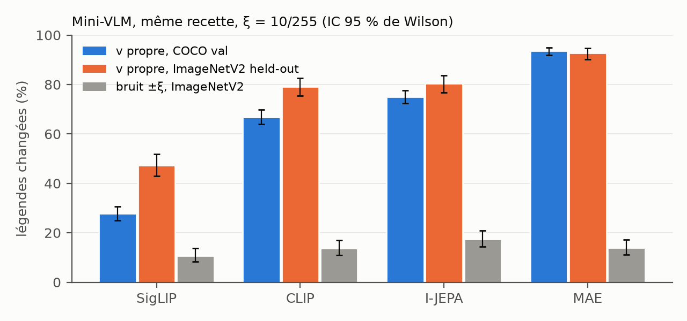
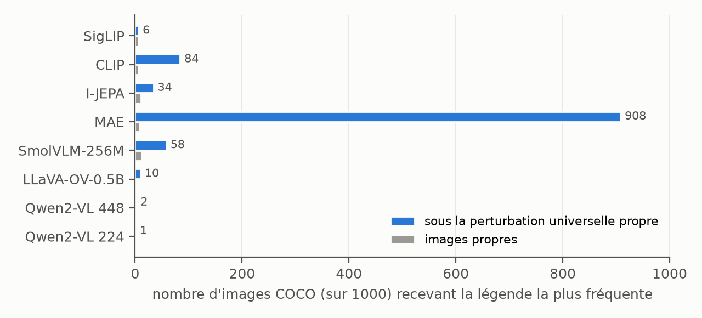
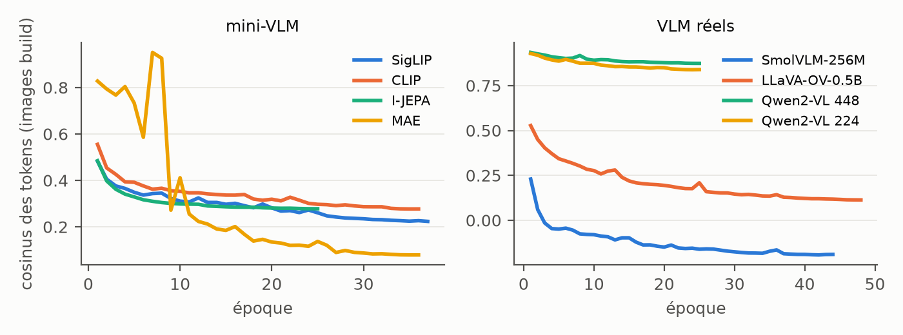
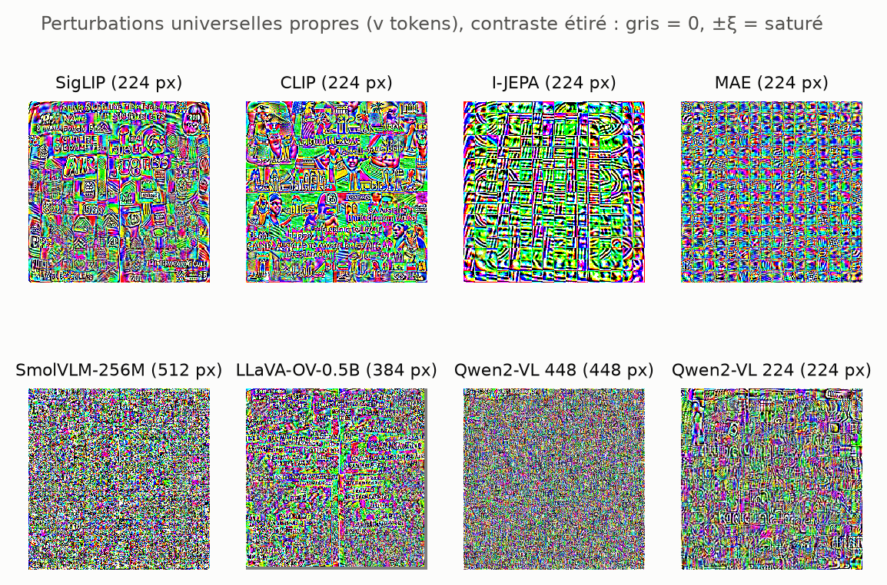
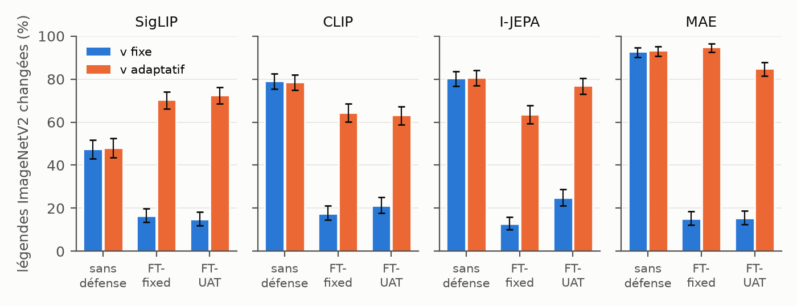
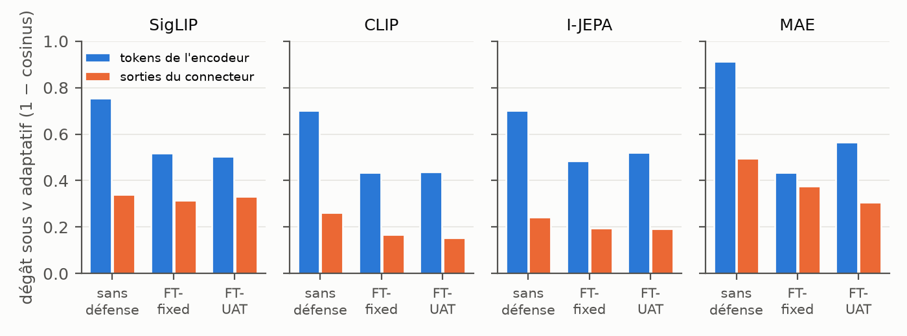
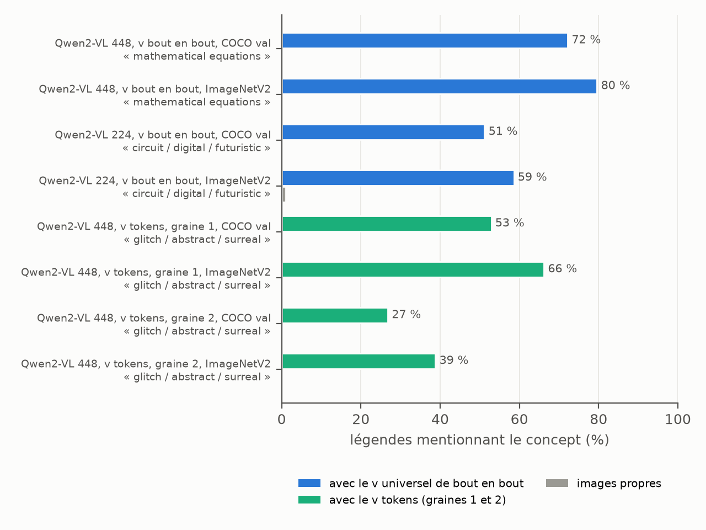
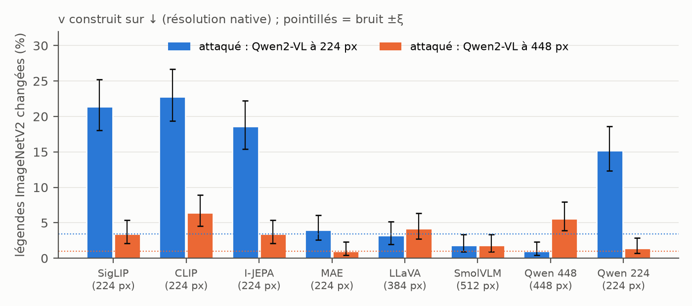
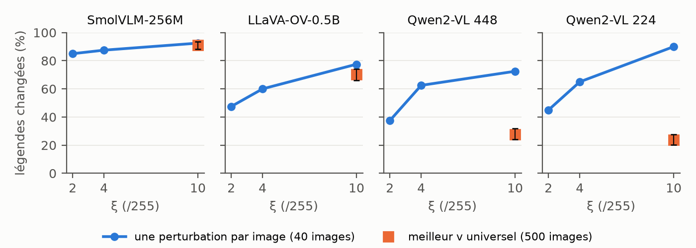

# Perturbations universelles contre les modèles vision-langage : rôle de l'encodeur, défenses, et modèles réels

Rapport d'expériences : protocole, résultats classés par niveau de confiance, conclusions, audit et limites.
État au 23 novembre 2026 au soir. Les résultats encore incomplets sont regroupés en annexe C.

---

## 0. Résumé

On mesure combien une **perturbation universelle** v change les légendes produites par des modèles vision-langage (VLM). Une perturbation universelle est un seul motif additif, de norme ‖v‖∞ ≤ 10/255, ajouté à toutes les images. Deux familles de modèles sont étudiées :
- quatre **mini-VLM** construits avec exactement la même recette, et qui ne diffèrent que par leur encodeur visuel gelé (SigLIP, CLIP, I-JEPA, MAE) ;
- quatre configurations de **VLM réels** pré-entraînés : SmolVLM-256M, LLaVA-OneVision-0.5B, et Qwen2-VL-2B à 448 et à 224 px.

**Conclusions principales :**

1. **La vulnérabilité universelle dépend fortement de l'encodeur.** Avec la même recette de mini-VLM, la perturbation propre change en moyenne sur 3 graines d'attaque :

   | Encodeur | Légendes COCO changées (moyenne sur 3 graines) |
   |---|---|
   | SigLIP | 31 % |
   | CLIP | 67 % |
   | I-JEPA | 77 % |
   | MAE | 94 % |

   L'écart entre graines (au plus 9 points) est bien plus petit que les écarts entre encodeurs.
2. **Une perturbation universelle peut contrôler la sortie de deux façons.**
   - **Remplacer** la légende : avec le v de MAE, 908 images COCO sur 1000 reçoivent exactement la même légende.
   - **Injecter un concept ou un style** sans effacer le contenu : avec Qwen2-VL, 72 % des légendes COCO (80 % sur ImageNetV2) se mettent à mentionner des « mathematical equations », absentes de toutes les légendes propres.
   - Une recherche automatique des mots injectés (partie IX) montre que l'injection est **générale** : « baseball / team / logo » chez LLaVA (53 % des légendes), « book » chez I-JEPA (jusqu'à 47 %), un effet « digital / glitch / abstract » chez Qwen2-VL (jusqu'à 66 %).
3. **Qwen2-VL n'est pas robuste aux perturbations universelles**, contrairement à ce que laissait croire une première attaque mal optimisée. Notre mesure principale (« légende changée ») sous-estime fortement ce mode d'attaque par injection.
4. **Défense par réglage fin de l'encodeur :**
   - coût négligeable sur les images propres ;
   - efficace contre la perturbation fixe ;
   - **inefficace contre une attaque adaptative**, et même **nuisible pour SigLIP** : 70,4 % de légendes changées contre 48,0 % sans défense, McNemar p ≈ 10⁻¹⁹.
   - Mesure du mécanisme : la défense protège les tokens de l'encodeur, mais pas ce que reçoit le modèle de langage.
5. **Il faut prendre le maximum sur plusieurs objectifs et plusieurs graines d'attaque.**
   - L'attaque « de bout en bout » sur la légende n'est pas une borne supérieure : pour CLIP elle est bien plus faible que l'attaque sur les tokens (44,6 % contre 79,2 %).
   - Sur Qwen2-VL 448, trois graines de la même attaque sur les tokens changent 5,6 %, 14,8 % et 13,4 % des légendes (graine 0 contre chacune des autres : McNemar p < 10⁻⁷). Les graines 1 et 2 injectent un style « glitch / abstract / digital » (66 % et 39 % des légendes, contre 0,6 % pour la graine 0). Le cosinus optimisé ne prédit pas ces écarts (0,878, 0,872, 0,826).

**Principales réserves :**
- la mesure « légende changée » (seuil MiniLM de 0,5) n'a pas été validée par des humains, et elle ne voit pas l'injection de concept ;
- les transferts entre modèles de résolutions différentes sont confondus avec le redimensionnement de la perturbation ;
- le code n'était pas versionné pendant la campagne (§ 4).

---

## 1. Question et protocole commun

### 1.1 Questions

- **Q1.** La façon dont l'encodeur visuel a été pré-entraîné change-t-elle la vulnérabilité d'un VLM à une perturbation universelle, toutes choses égales par ailleurs ?
- **Q2.** Quel objectif faut-il attaquer (tokens de l'encodeur, sorties du connecteur, légende) ?
- **Q3.** Une défense par réglage fin de l'encodeur résiste-t-elle à un attaquant qui la connaît, et combien coûte-t-elle sur les images propres ?
- **Q4.** Les conclusions tiennent-elles sur de vrais VLM pré-entraînés ?

### 1.2 Données

| Ensemble | Contenu | Usage | Code |
|---|---|---|---|
| ImageNetV2 matched-frequency | 10 000 images ; liste triée, `np.random.RandomState(0).permutation` ; 500 premières = **build**, 500 suivantes = **held-out** | La perturbation est construite **uniquement sur build** ; les légendes changées sont mesurées sur held-out | [common.py](common.py) `imagenetv2_split` |
| COCO train2017 | 118 287 images, 5 légendes humaines chacune | Entraînement des mini-VLM | `CocoCaptions` |
| COCO val2017 | Les 1000 premières images (ids triés) | Qualité (CIDEr) et attaque face aux légendes humaines ; jamais vu à l'entraînement | [eval_coco.py](eval_coco.py) |

**Préprocessing :**
- `Resize(côté court) + CenterCrop`, sans étirement ;
- 224 px pour les mini-VLM ; pour les VLM réels, 512 (SmolVLM), 384 (LLaVA), 448 ou 224 (Qwen2-VL) ;
- le champ de vue est le même partout ;
- chaque image perturbée est **arrondie à 8 bits** avant d'être légendée.

Téléchargement des données : [prepare_data.sh](prepare_data.sh).

### 1.3 Modèles

**Mini-VLM** ([common.py](common.py), [train_connector.py](train_connector.py)) :

| Encodeur gelé (HF) | Pré-entraînement | Taille |
|---|---|---|
| `google/siglip-so400m-patch14-224` | contrastif image–texte (sigmoïde), WebLI | ~400M |
| `openai/clip-vit-large-patch14` | contrastif image–texte (softmax), 400M paires | ~300M |
| `facebook/ijepa_vith14_1k` | prédiction dans l'espace des features, ImageNet-1k | ~630M |
| `facebook/vit-mae-huge` (sans masquage, ordre des patches conservé) | reconstruction de pixels, ImageNet-1k | ~630M |

Les parties communes sont les suivantes :
- **Encodeur :** ViT patch 14 à 224 px, soit 256 tokens ; le token CLS est retiré.
- **Connecteur :** LayerNorm, pixel-shuffle 2×2 (64 tokens), puis MLP à 2 couches.
- **Modèle de langage :** SmolLM2-135M-Instruct.
- **Prompt :** « Describe this image in one sentence. ».
- **Décodage :** glouton, 40 tokens au maximum.

L'entraînement se fait sur COCO train2017 :

| Étape | Ce qui est entraîné | Époques | Batch | Learning rate | Planning |
|---|---|---|---|---|---|
| 1 | connecteur seul | 1 | 64 | 1e-3 | warmup 100 pas puis cosinus |
| 2 | connecteur + LoRA r = 16 sur toutes les projections | 1 | 32 | 2e-4 | warmup 100 pas puis cosinus |

Autres réglages : AdamW, bf16, clip de gradient à 1, graine 0.

Variante **siglip-unfrozen** ([run_unfrozen.sh](run_unfrozen.sh)) : même étape 1 (copiée), puis une étape 2 où l'encodeur est aussi entraîné (lr 2e-6).

**VLM réels** ([real_vlm.py](real_vlm.py)) : uniquement des classes natives de transformers, sans code distant ; bf16.

| Nom | Checkpoint HF | Encodeur | Résolution | Tokens attaqués |
|---|---|---|---|---|
| smolvlm-256m | HuggingFaceTB/SmolVLM-256M-Instruct | SigLIP-B/16 | 512, 1 vue | 1024 × 768 |
| llava-ov-0.5b | llava-hf/llava-onevision-qwen2-0.5b-ov-hf | SigLIP-SO400M | 384 ; 2 vues identiques (anyres) | 729 × 1152 |
| qwen2-vl-2b | Qwen/Qwen2-VL-2B-Instruct | ViT de Qwen2-VL (RoPE 2D) | 448 | 1024 × 1280 (entrée du merger) |
| qwen2-vl-2b-224 | idem | idem | 224 | 256 × 1280 |

Le gradient de l'attaque traverse une **copie différentiable du préprocessing**. Cette copie est vérifiée au démarrage contre le processeur officiel : écart maximal 0,0000 pour les quatre configurations (`sanity_check`, dans les logs). Les légendes sont produites par le **vrai pipeline** : image PIL 8 bits → processeur → `generate`.

### 1.4 Attaques

Toutes les attaques passent par `converge_uap` ([common.py](common.py)).

**Optimisation :**
- Adam sur v, puis projection sur la boule ℓ∞ de rayon ξ = 10/255 ;
- batch de 8 ;
- après chaque époque, v est évalué sur les 500 images build (arrondies à 8 bits), et le meilleur v est conservé ;
- **plateau** : si le gain est inférieur à 0,001 pendant 2 époques, on repart du meilleur v avec un pas divisé par 2 ;
- **arrêt** après 3 divisions du pas, au minimum 10 époques (7 pour l'attaque adaptative) et au maximum 60.

**Graines :**
- la graine 0 (runs d'origine) part de v = 0 ;
- les graines 1 et 2 (`--seed`) partent d'un point aléatoire de la boule et parcourent les images dans un autre ordre.

**Objectifs :**

| Nom | Objectif minimisé | Pas initial | Fichier |
|---|---|---|---|
| v tokens | cosinus moyen entre tokens propres et perturbés | 1/255 | `uap_xi10.pt`, `uap_xi10_s{1,2}.pt` |
| v connecteur | cosinus des 64 sorties du connecteur | 1/255 | `uap_conn_xi10.pt` |
| v de bout en bout (« caption loss ») | vraisemblance exp(−CE moyenne) de la légende propre du modèle, à travers tout le modèle | 4/255 pour les mini-VLM ; 1/255 pour SmolVLM ; **0,5/255 pour Qwen2-VL** | `uap_cap_xi10.pt` |
| bruit aléatoire | signe ±ξ aléatoire, **5 tirages** | — | — |
| par image | PGD par signe, 100 pas, α = 2,5ξ/100, même objectif que le v de bout en bout | — | [single_image.py](single_image.py) |

### 1.5 Métriques

| Métrique | Définition | Remarque |
|---|---|---|
| **changed** | similarité MiniLM (all-MiniLM-L6-v2) entre la légende perturbée et la légende propre **du même modèle** < 0,5 | métrique principale ; reprise du rapport SmolVLM précédent ; **ne voit pas l'injection de concept** (VI.2) |
| changed@0.7 | même chose avec un seuil de 0,7 | trop sensible (§ 4.3) : non utilisée pour conclure |
| **wrong** | la meilleure similarité MiniLM avec les 5 légendes humaines COCO est < 0,5 | mesure si la légende devient fausse, et pas seulement différente |
| injection (concept) | part des légendes qui mentionnent le concept injecté (expression régulière), comparée aux légendes propres | utilisée pour Qwen2-VL (VI.2, VI.7) ; le concept est identifié en lisant les légendes |
| mots injectés (automatique) | mots présents dans ≤ 1 % des légendes propres et ≥ 10 % des légendes perturbées, mêmes images, mots vides retirés | [injection_scan.py](injection_scan.py) (partie IX) ; seuils fixés avant de regarder le résultat, mais arbitraires |
| CIDEr | pycocoevalcap, au niveau du corpus, sur 1000 images COCO val | **comparable seulement entre conditions d'un même modèle** (§ 4.4) |
| cosinus des tokens / du connecteur | cosinus moyen des features, propres contre perturbées, sur les images held-out | 1 = inchangé |
| précision ImageNet lue dans la légende | la légende est rapprochée par MiniLM de « a photo of a ⟨synonyme⟩ » pour les 1000 classes ; top-1 et top-5 | [imagenet_accuracy.py](imagenet_accuracy.py) ; mesure l'informativité de la légende, pas un classifieur |

Pour la statistique :
- chaque taux est donné avec un **intervalle de Wilson à 95 %** ;
- les comparaisons clés sur les mêmes images utilisent un **test de McNemar exact** (binomial sur les paires discordantes). Ces tests ont été calculés pour ce rapport à partir des fichiers de légendes.

### 1.6 Exécution et environnement

- **Machines :** deux postes de l'école, espagne et allemagne.
- **Environnement** (enregistré dans `results/env_*.txt`) :
  - GPU NVIDIA RTX A4000 (16 Go), pilote 595.104, CUDA 13.2 ;
  - Python 3.9.25, torch 2.8.0, transformers 4.57.6, peft 0.17.1, sentence-transformers 5.1.2, pycocoevalcap 1.2.
- **Répartition** (d'après les consignes de lancement) :
  - espagne : mini-VLM ijepa et clip, SmolVLM-256M, LLaVA ;
  - allemagne : mini-VLM mae et siglip, siglip-unfrozen, Qwen2-VL (448 et 224).
- **Stockage :** données et poids sur le disque local `/Data/...` ; résultats dans `results/<modèle>/` du home partagé, synchronisés sur le PC par rsync.

### 1.7 Traçabilité : du résultat au fichier

| Résultat | Script(s) | Commande | Fichiers produits |
|---|---|---|---|
| Entraînement des mini-VLM | [train_connector.py](train_connector.py) | `./run_minivlm.sh <enc>` | `connector_stage{1,2}.pt`, `lora_stage2/`, `train_stage*_log.jsonl`, `log_train.txt` |
| v tokens et v connecteur, dégâts sur les tokens, transferts | [uap_encoder.py](uap_encoder.py) | `./run_converged.sh <enc>` | `uap_xi10.pt`, `uap_conn_xi10.pt`, `*_history.json`, `uap_xi10_tokens.json`, `log_uap.txt` |
| v de bout en bout (mini-VLM) | [uap_encoder.py](uap_encoder.py) `--target caption` | `./run_endtoend.sh`, `./run_complete.sh` | `uap_cap_xi10.pt`, `build_captions.json`, `uap_cap_xi10_tokens.json` |
| Graines d'attaque, tirages de bruit | [uap_encoder.py](uap_encoder.py) / [real_vlm.py](real_vlm.py) `--seed k`, `common.extra_conditions` | `./run_complete.sh <machine>` | `uap_xi10_s{1,2}.pt` ; conditions « seed k » et « random ±xi, draw k » |
| Légendes COCO (CIDEr, wrong, changed) | [eval_coco.py](eval_coco.py) | dans les scripts `run_*.sh` | `coco_stage2.json`, `coco_captions_stage2.json` |
| Légendes ImageNetV2 held-out | [evaluate_captions.py](evaluate_captions.py) | idem | `eval_captions_stage2_xi10.json`, `captions_stage2_xi10.json` |
| Défense et attaque adaptative | [defense_finetune.py](defense_finetune.py) | dans `run_converged.sh` | `defense_ft.json`, `defense_ft_captions.json`, `adaptive_xi10_*.pt`, `log_defense.txt` |
| Mécanisme de la défense | [defense_mechanism.py](defense_mechanism.py) | `./run_complete.sh <machine>` | `defense_mechanism.json` |
| Encodeur dégelé | [train_connector.py](train_connector.py), [uap_encoder.py](uap_encoder.py) | `./run_unfrozen.sh siglip` | `results/siglip-unfrozen/` |
| SmolVLM avec le v du rapport précédent | [smolvlm_reference.py](smolvlm_reference.py) | `SMOLVLM=1 ./run_converged.sh ...` | `results/smolvlm/`, dont `encoder_vs_original.json` |
| VLM réels, v tokens | [real_vlm.py](real_vlm.py) | `./run_real_vlm.sh <modèle>` | `results/<modèle>/uap_xi10*.{pt,json}`, `coco_*`, `*captions*`, `log.txt` |
| VLM réels, v de bout en bout | [real_vlm.py](real_vlm.py) `--target caption --lr` | `./run_endtoend.sh`, `./run_complete.sh` | `uap_cap_xi10.pt`, `build_caption_ids.json` |
| Attaque par image | [single_image.py](single_image.py) | `./run_single.sh <modèle>` | `single_image.json`, `log_single.txt` |
| Précision ImageNet lue dans les légendes | [imagenet_accuracy.py](imagenet_accuracy.py) | `python imagenet_accuracy.py` | `results/imagenet_accuracy.json` |
| Mots injectés (recherche automatique) | [injection_scan.py](injection_scan.py) | `python injection_scan.py` | `results/injection_scan.json` |
| Tableaux de synthèse | [compare.py](compare.py) | `python compare.py` | `results/comparison.md` |
| Figures | [make_figures.py](make_figures.py) | `python make_figures.py` (`--lang en` pour l'anglais) | `results/figures/*.png`, `results/figures_en/*.png` |
| PDF du rapport | [build_pdf.py](build_pdf.py) | `python build_pdf.py` ; `python build_pdf.py REPORT_EN.md` | `RAPPORT.pdf`, `REPORT_EN.pdf` |

---

## 2. Résultats

**Légende de confiance :**
- **[A] solide** : effet grand devant les contrôles (bruit aléatoire, plancher numérique, variance entre graines), intervalles disjoints ou McNemar p < 10⁻⁵, sans dépendance critique à un choix arbitraire.
- **[B] probable** : effet net, mais il dépend d'un choix (métrique, résolution) ou il manque un contrôle.
- **[C] préliminaire** : petit échantillon, comparaison non appariée, ou effet proche du plancher de bruit.

Dans chaque partie, les résultats vont du plus sûr au moins sûr.

**Plancher de bruit à garder en tête :**
- 5 tirages de bruit ±ξ changent en moyenne 4,8 à 9,4 % des légendes COCO des mini-VLM, et 11,1 à 17,4 % sur ImageNetV2 ;
- pour les VLM réels, ils en changent 0,9 à 4,4 % ;
- deux pipelines numériquement différents du même SmolVLM (fp32 contre bf16) diffèrent déjà sur 4,8 % (COCO) et 7,6 % (ImageNetV2) des légendes (§ 4.3).

Un écart de moins d'environ 10 points n'est donc interprétable qu'avec un test apparié.

### Partie I : vulnérabilité selon l'encodeur (mini-VLM, Q1)

Données : `results/{siglip,clip,ijepa,mae}/`. La perturbation est celle du modèle, optimisée jusqu'à convergence ; seules les lignes « 3 graines » utilisent les trois graines.

| | SigLIP | CLIP | I-JEPA | MAE |
|---|---|---|---|---|
| CIDEr propre (COCO, 1000 images) | 1,175 | 1,020 | 0,909 | 0,919 |
| wrong, propre | 2,9 % (2–4) | 7,1 % (6–9) | 15,9 % (14–18) | 13,6 % (12–16) |
| **changed, v propre, COCO, graine 0** | **27,8 %** (25–31) | **66,9 %** (64–70) | **75,1 %** (72–78) | **93,6 %** (92–95) |
| changed, v propre, COCO, 3 graines : moyenne [min–max] | 30,9 % [27,8–36,6] | 67,0 % [64,7–69,3] | 77,1 % [75,1–79,4] | 93,7 % [93,1–94,3] |
| changed, v propre, ImageNetV2, 3 graines | 48,4 % [45,6–52,2] | 79,4 % [77,8–81,2] | 81,5 % [80,4–83,2] | 93,3 % [92,6–94,4] |
| changed, bruit ±ξ (5 tirages), COCO / ImageNetV2 | 5,2 % / 11,1 % | 4,8 % / 13,8 % | 9,4 % / 17,4 % | 6,3 % / 15,3 % |
| wrong, v propre (graine 0) | 21,6 % | 64,1 % | 75,0 % | 93,1 % |
| cosinus des tokens, v propre (held-out) | 0,253 | 0,303 | 0,299 | 0,092 |
| légendes COCO distinctes sous v (sur 1000) | 960 | 681 | 711 | **54** |

**I.1 [A]** SigLIP est nettement le moins vulnérable et MAE le plus vulnérable.
- Les plages couvertes par les 3 graines ne se recouvrent pas entre SigLIP, le groupe CLIP / I-JEPA, et MAE.
- Les légendes ne font pas que changer : elles deviennent **fausses** (« wrong » suit « changed »).
- La variance due à l'attaque est faible (au plus 9 points, pour SigLIP) devant les écarts entre encodeurs (30 à 60 points).

**I.2 [A]** Avec MAE, la perturbation universelle **impose une légende quasi unique**. 908 des 1000 images COCO reçoivent « A group of people standing next to each other. », et il ne reste que 54 légendes distinctes. CLIP montre une forme plus faible du même phénomène : 84 fois la même légende. C'est l'équivalent, pour la génération de texte, de la « classe dominante » des perturbations universelles sur les classifieurs.

**I.3 [B]** Les dégâts sur les tokens ne suffisent pas à prédire les dégâts sur les légendes. SigLIP, CLIP et I-JEPA ont des cosinus de tokens comparables (0,25 à 0,30), mais 28 à 75 % de légendes changées. Le connecteur et le modèle de langage de SigLIP semblent ignorer une grande partie des directions détruites (voir aussi II.2 et IV.3).

**I.4 [B]** L'écart entre CLIP et I-JEPA n'est net que sur COCO. Sur ImageNetV2, leurs plages de graines se touchent (79,4 % contre 81,5 %). Le classement entre ces deux-là dépend aussi de l'effort d'optimisation :

| | COCO, 10 époques | COCO, convergence |
|---|---|---|
| SigLIP | 20,7 % | 27,8 % |
| CLIP | 50,6 % | 66,9 % |
| I-JEPA | 70,5 % | 75,1 % |
| MAE | 57,4 % | 93,6 % |

À 10 époques, MAE paraissait même moins vulnérable qu'I-JEPA (`results/old_10epochs/`). La figure 6 montre pourquoi. Pendant 9 époques, l'attaque contre MAE oscille entre 0,6 et 0,95 de cosinus. Elle s'effondre ensuite brutalement (0,27 à l'époque 9), puis descend jusqu'à 0,08. **Une attaque arrêtée trop tôt peut inverser un classement.**

**I.5 [B]** Les perturbations universelles de SigLIP et de CLIP contiennent des **motifs typographiques et des visages** lisibles (figure 7) : des mots (« AIR », « Australia »), des logos, des portraits. Celles d'I-JEPA et de MAE sont des textures périodiques, à l'échelle du patch de 14 px pour MAE. C'est cohérent avec un pré-entraînement image–texte, où le texte écrit dans l'image est un signal fort. C'est une observation qualitative, pas une mesure.

**I.6 [C]** On ne peut pas attribuer la différence au seul **objectif** de pré-entraînement. Les encodeurs diffèrent aussi par la taille, les données et la qualité propre obtenue : CIDEr de 0,91 à 1,18, wrong propre de 2,9 % à 15,9 %. La paire la plus propre est I-JEPA / MAE (même architecture ViT-H/14, mêmes données ImageNet-1k) : 77 % contre 94 % sur 3 graines, ce qui suggère un effet de l'objectif (prédire des features plutôt que reconstruire des pixels). Mais il n'y a qu'un seul entraînement de connecteur par encodeur.

### Partie II : quel objectif attaquer ? (Q2)

Légendes ImageNetV2 held-out changées, selon l'objectif de l'attaque (graine 0) :

| | SigLIP | CLIP | I-JEPA | MAE | SmolVLM-256M | Qwen2-VL 448 | Qwen2-VL 224 |
|---|---|---|---|---|---|---|---|
| v tokens | 47,4 % | **79,2 %** | **80,4 %** | 92,8 % | **91,2 %** | 5,6 % | 15,2 % |
| v connecteur | 44,4 % | 50,8 % | 77,4 % | 74,8 % | — | — | — |
| v de bout en bout | **48,4 %** | 44,6 % | 70,4 % | **93,4 %** | 63,6 % | **27,8 %** | **23,8 %** |

**II.1 [A]** **Aucun objectif ne domine.** L'attaque sur les tokens est la meilleure pour CLIP, I-JEPA et SmolVLM. L'attaque de bout en bout est la seule efficace sur Qwen2-VL. Pour CLIP, l'écart est massif : 44,6 % contre 79,2 %, McNemar 15 contre 188 paires discordantes, p ≈ 3·10⁻³⁹.

L'optimisation d'une perturbation universelle n'est pas convexe, et des objectifs différents trouvent des optima différents. Le v tokens de CLIP produit une légende dominante ; le v de bout en bout n'en produit pas. **Pour mesurer une vulnérabilité, il faut retenir le maximum sur plusieurs attaques.**

**II.2 [A]** Pour SigLIP, les trois objectifs plafonnent au même niveau : 44 à 48 %, différence tokens / bout en bout non significative (p = 0,76). C'est l'indice le plus fort que sa résistance ne vient pas d'un mauvais choix d'objectif.

**II.3 [B]** Une vraisemblance quasi nulle de la légende propre ne garantit pas un changement de sens. Pour SmolVLM, le v de bout en bout fait tomber cette vraisemblance à 0,001 sur les images build, mais ne change que 63,6 % des légendes held-out, contre 91,2 % pour le v tokens. Le modèle peut rendre la légende exacte improbable tout en gardant son sens.

**II.4 [B]** Viser les sorties du connecteur, c'est-à-dire ce que reçoit le modèle de langage, n'est jamais meilleur que viser les tokens. Rien ne permet d'en expliquer la raison.

### Partie III : transfert entre mini-VLM

Taux de légendes COCO changées. Les lignes indiquent sur quel modèle v a été construit, les colonnes le modèle attaqué. Tous les v sont à 224 px, donc **aucun redimensionnement**.

| v construit sur ↓ / attaqué → | SigLIP | CLIP | I-JEPA | MAE |
|---|---|---|---|---|
| SigLIP | (27,8 %) | 14,0 % | 14,1 % | 17,6 % |
| CLIP | 16,7 % | (66,9 %) | 12,2 % | 17,2 % |
| I-JEPA | 10,6 % | 10,8 % | (75,1 %) | **27,3 %** |
| MAE | 7,1 % | 6,5 % | 11,7 % | (93,6 %) |
| SmolVLM (rapport précédent, 512 → 224) | 2,8 % | 4,2 % | 5,3 % | 4,4 % |
| bruit ±ξ (5 tirages) | 5,2 % | 4,8 % | 9,4 % | 6,3 % |

**III.1 [A]** Le transfert est faible : 6,5 à 17,6 %, contre 4,8 à 9,4 % pour le bruit. Il y a une exception : **I-JEPA → MAE, 27,3 %**, la paire de même architecture et de mêmes données. Le transfert est asymétrique : MAE → I-JEPA ne donne que 11,7 %. MAE, le plus vulnérable, est aussi la cible la plus facile pour tous les transferts.

**III.2 [B]** Le v de SmolVLM du rapport précédent ne transfère pas (2,8 à 5,3 %). Mais il est **réduit de 512 à 224 px** avec anti-aliasing, ce qui efface ses détails fins (VI.5). Ce résultat ne dit donc rien de sa transférabilité réelle.

### Partie IV : défense par réglage fin de l'encodeur (Q3)

**Recette** ([defense_finetune.py](defense_finetune.py), reprise du notebook 07) :
- tout l'encodeur est réglé sur les 500 images build, pendant 3 époques (Adam, lr 1e-5, batch 8) ;
- la perte ancre les tokens perturbés **et** les tokens propres sur les tokens d'origine : 1 − cos ;
- le connecteur et le modèle de langage ne sont pas réentraînés ;
- **FT-fixed** se défend contre le v fixe ; **FT-UAT** suit Shafahi et al. 2020, avec un pas d'Adam sur v après chaque pas de l'encodeur ;
- l'attaque adaptative est un nouveau v, initialisé avec le v d'origine et optimisé jusqu'à convergence contre l'encodeur réglé ;
- **no-defense** applique la même procédure adaptative à l'encodeur d'origine : c'est la référence à effort d'attaque égal.

Dans chaque case, la première valeur porte sur COCO et la seconde sur ImageNetV2 held-out (légendes changées).

| | SigLIP | CLIP | I-JEPA | MAE |
|---|---|---|---|---|
| CIDEr propre : origine → FT-fixed / FT-UAT | 1,175 → 1,170 / 1,174 | 1,020 → 1,006 / 1,002 | 0,909 → 0,906 / 0,900 | 0,919 → 0,925 / 0,925 |
| Coût propre (légendes changées contre le modèle d'origine), FT-fixed | 2,0 % / 5,8 % | 4,2 % / 11,6 % | 2,9 % / 8,2 % | 2,0 % / 3,4 % |
| no-defense, v fixe | 27,8 % / 47,4 % | 66,9 % / 79,2 % | 75,1 % / 80,4 % | 93,6 % / 92,8 % |
| FT-fixed, v fixe | 6,9 % / 16,4 % | 7,9 % / 17,6 % | 7,8 % / 12,8 % | 7,1 % / 15,2 % |
| no-defense, v adaptatif | 28,7 % / **48,0 %** | 69,4 % / **78,6 %** | 75,5 % / **80,8 %** | 93,6 % / **93,2 %** |
| FT-fixed, v adaptatif | 64,6 % / **70,4 %** | 53,0 % / 64,4 % | 57,3 % / 63,6 % | 96,4 % / 94,8 % |
| FT-UAT, v adaptatif | 67,8 % / **72,6 %** | 51,6 % / 63,2 % | 76,2 % / 77,0 % | 85,1 % / 85,0 % |

Tests de McNemar sur ImageNetV2, v adaptatif, défense contre no-defense :

| | SigLIP | CLIP | I-JEPA | MAE |
|---|---|---|---|---|
| FT-fixed | **pire**, p ≈ 2·10⁻¹⁹ | mieux, p ≈ 2·10⁻⁹ | mieux, p ≈ 4·10⁻¹³ | non significatif, p = 0,24 |
| FT-UAT | **pire**, p ≈ 3·10⁻²¹ | mieux, p ≈ 10⁻¹¹ | non significatif, p = 0,07 | mieux, p ≈ 2·10⁻⁶ |

**IV.1 [A]** Le coût propre est **négligeable**.
- Le CIDEr bouge de moins de 0,02, et « wrong » propre reste dans l'intervalle d'origine.
- Les 3,4 à 11,6 % de légendes ImageNetV2 qui changent sont du même ordre que le bruit aléatoire (11 à 17 %).
- La précision ImageNet lue dans les légendes ne baisse pas (SigLIP : 14,4 % → 15,0 % top-1).

Ce qui suit ne vient donc **pas** d'un modèle dégradé.

**IV.2 [A]** Contre le v **fixe**, la défense fonctionne. Les légendes changées sur COCO tombent de 28 à 94 % à environ 7 à 8 %, proche du bruit aléatoire.

**IV.3 [A]** Contre un attaquant **adaptatif**, la défense ne tient pas. Pour **SigLIP, elle aggrave la situation** : 70,4 à 72,6 % de légendes ImageNetV2 changées, contre 48,0 % sans défense.

**IV.4 [B] Mécanisme mesuré** ([defense_mechanism.py](defense_mechanism.py), figure 9). Sous le v adaptatif, on mesure séparément le dégât sur les tokens de l'encodeur et le dégât sur les sorties du connecteur, qui sont ce que reçoit le modèle de langage.

| Cosinus sous v adaptatif (tokens / connecteur) | SigLIP | CLIP | I-JEPA | MAE |
|---|---|---|---|---|
| no-defense | 0,246 / 0,660 | 0,299 / 0,736 | 0,298 / 0,756 | 0,087 / 0,504 |
| FT-fixed | 0,482 / 0,685 | 0,565 / 0,832 | 0,515 / 0,804 | 0,566 / 0,625 |
| FT-UAT | 0,496 / 0,667 | 0,563 / 0,846 | 0,479 / 0,806 | 0,435 / 0,694 |

- **Pour les quatre encodeurs,** la défense divise environ par deux le dégât sur les **tokens**.
- **Pour SigLIP,** le dégât sur les **sorties du connecteur** reste le même (0,66 → 0,67–0,69). L'attaquant adaptatif a reporté son effort sur les directions que le connecteur transmet. Protéger l'encodeur ne protège pas ce que lit le modèle de langage.
- **Pour CLIP et I-JEPA,** le connecteur est un peu mieux protégé (0,74 → 0,83–0,85 ; 0,76 → 0,80), et les légendes changent moins. C'est cohérent.
- **Le cosinus du connecteur ne suffit pas à tout expliquer.** Pour SigLIP, un dégât égal au connecteur produit **plus** de légendes changées (70 % contre 48 %). Pour I-JEPA, FT-fixed et FT-UAT ont le même cosinus de connecteur (0,80) mais 64 % contre 77 % de légendes changées. Le modèle de langage est plus sensible à certaines directions qu'à d'autres, et un cosinus moyen ne le capture pas.

**IV.5 [B]** Pour CLIP et I-JEPA (FT-fixed), le gain adaptatif est réel mais modeste : environ 15 points. FT-UAT n'est pas meilleur que FT-fixed, alors que la littérature le présente comme la version robuste. Avec 3 époques sur 500 images, l'adversaire de l'UAT n'a peut-être pas eu le temps de devenir fort. C'est un manque de budget, pas une conclusion sur l'UAT.

**IV.6 [B]** Les attaques adaptatives contre les encodeurs défendus ont tourné plus longtemps (19 à 51 époques) que no-defense (9 à 13 époques, avec démarrage depuis un v déjà convergé). Le critère d'arrêt est le même.

### Partie V : post-entraînement avec encodeur dégelé (SigLIP uniquement)

| | SigLIP gelé | SigLIP dégelé |
|---|---|---|
| CIDEr propre | 1,175 | 1,200 |
| v de l'encodeur d'origine (fixe), COCO / ImageNetV2 | 27,8 % / 47,4 % | 24,1 % / 43,6 % |
| v recalculé (tokens) | 27,8 % / 47,4 % | 22,5 % / 42,8 % |
| v recalculé (connecteur) | 25,7 % / 44,4 % | 19,9 % / 37,8 % |

**V.1 [C]** Dégeler l'encodeur ne rend pas le modèle plus vulnérable. Avec la variance entre graines de SigLIP (27,8 à 36,6 % sur COCO), l'écart observé (22,5 % contre 27,8 %) n'est pas significatif. Un seul encodeur a été testé.

### Partie VI : VLM réels, perturbations universelles (Q4)

| | SmolVLM-256M | LLaVA-OV-0.5B | Qwen2-VL 448 | Qwen2-VL 224 |
|---|---|---|---|---|
| wrong propre (COCO) | 23,9 % | 5,8 % | 1,6 % | 4,7 % |
| précision ImageNet top-1 lue dans la légende (propre) | 14,8 % | 36,4 % | 42,8 % | 41,2 % |
| changed, bruit ±ξ (5 tirages), COCO / ImageNetV2 | 2,1 % / 4,4 % | 2,1 % / 2,2 % (1 tirage) | 0,9 % / 1,4 % | 2,4 % / 3,4 % |
| changed, v tokens, COCO / ImageNetV2 | **88,2 % / 91,2 %** | **60,9 % / 70,2 %** | 2,2 % / 5,6 % | 10,7 % / 15,2 % |
| changed, v tokens, graines, ImageNetV2 | 3 graines : 92,6 % [91,2–93,4] | annexe C | **3 graines : 5,6 %, 14,8 %, 13,4 %** | 3 graines : 17,7 % [15,2–21,4] |
| changed, v de bout en bout, COCO / ImageNetV2 | 58,7 % / 63,6 % | annexe C | 18,6 % / **27,8 %** | 16,5 % / **23,8 %** |
| **légendes avec le concept injecté** (v de bout en bout), COCO / ImageNetV2 | — | — | **72 % / 80 %** | **51 % / 59 %** |
| légendes avec le style « glitch / abstract / surreal » (v tokens), COCO / ImageNetV2 | — | — | graine 0 : 0,4 % / 0,6 % ; **graine 1 : 53 % / 66 % ; graine 2 : 27 % / 39 %** | voir IX |
| cosinus des tokens, v tokens / v de bout en bout | −0,078 / — | 0,168 / — | 0,878 / 0,931 | 0,849 / 0,919 |
| précision ImageNet top-1 sous v de bout en bout | 12,8 % | — | 34,6 % | 31,8 % |

**VI.1 [A]** SmolVLM-256M et LLaVA-OV sont très vulnérables à leur propre perturbation universelle : 88 à 93 % et 61 à 70 % des légendes changent. Ces légendes sont fausses (wrong 93,7 % et 58,9 %). Le v du rapport précédent, appliqué à SmolVLM-256M à 512 px sans redimensionnement, change 90,5 % des légendes COCO. Cela recoupe le rapport.

**VI.2 [A] Qwen2-VL n'est pas robuste aux perturbations universelles : la perturbation lui fait voir un objet qui n'existe pas.**

Avec un pas d'optimisation adapté (0,5/255, 47 époques), le v de bout en bout de Qwen 448 change 27,8 % des légendes ImageNetV2 selon notre métrique. C'est bien plus que le v tokens (5,6 %, McNemar 118 contre 7, p ≈ 4·10⁻²⁷). Surtout, les légendes montrent un mode d'attaque **par injection** :

- « A blue jay perches on a branch amidst lush green foliage. » → « A blue jay perched on a tree branch **with mathematical equations and symbols floating around**… »
- « A close-up of a snake's head… » → « The image features a python **with mathematical equations and symbols floating around it**… »

**72 % des légendes COCO et 80 % des légendes ImageNetV2** mentionnent des équations mathématiques, contre **0** sans perturbation. À 224 px, c'est le concept « circuit / digital / futuristic » : 51 % et 59 %, contre 0,2 et 1 % sans perturbation.

Qwen décrit encore le sujet principal, mais l'attaquant contrôle une partie de chaque légende. La métrique « changed » ne compte que les légendes dont le **sens global** change, et sous-estime donc fortement ce mode d'attaque. Les tokens de l'encodeur sont à peine modifiés (cosinus 0,93, contre 0,95 pour le bruit). Une mesure au niveau des features ne verrait rien.

**VI.3 [A, sur le plan méthodologique]** La première conclusion « Qwen2-VL est robuste aux perturbations universelles » venait d'une **attaque mal optimisée** :
- un premier run avec un pas de 4/255, arrêté après 23 époques (score 0,36), donnait seulement 7,8 % de légendes changées ;
- le run avec un pas de 0,5/255 atteint un score de 0,19 et 27,8 %, avec 80 % d'injection.

C'est le même piège qu'en I.4 : **conclure à la robustesse demande une attaque dont on a vérifié qu'elle est allée au bout.**

**VI.4 [C]** On ne peut pas conclure que la haute résolution protège.
- Avec l'objectif tokens, la graine 0 donnait Qwen 224 plus vulnérable que Qwen 448 (15,2 % contre 5,6 %). Mais les graines 1 et 2 de Qwen 448 atteignent 14,8 % et 13,4 %, près de la plage des 3 graines de Qwen 224 (15,2 à 21,4 % ; moyennes sur 3 graines : 11,3 % contre 17,7 %). L'écart venait en grande partie de la graine 0 (VI.7).
- Avec l'objectif de bout en bout, l'ordre s'inverse (23,8 % contre 27,8 %, comparaison non appariée, une seule graine).

**VI.5 [A, sur le plan méthodologique]** Les transferts entre résolutions différentes sont **dominés par le redimensionnement**.
- Le v tokens de Qwen 448, réduit à 224 px, ne change que **1,0 %** des légendes du **même modèle** à 224 px, soit autant que le bruit.
- Tous les v réduits (448, 384 ou 512 → 224) tombent au niveau du bruit (1,0 à 3,2 %).
- Les v à 224 px agrandis à 448 tombent à 1 à 6 %.

Les tableaux de transfert entre VLM réels ne mesurent donc pas la transférabilité.

**VI.6 [B]** Des v calculés sur des mini-VLM à 224 px (CLIP, SigLIP, I-JEPA) trompent Qwen2-VL 224 au moins aussi bien que son propre v tokens (18,6 à 22,8 %, contre 15,2 à 21,4 % sur 3 graines). Le v de MAE ne transfère pas (4,0 %). Ce n'est donc pas un effet générique des perturbations à 224 px.

**VI.7 [B] Sur Qwen2-VL 448, la graine d'attaque change le résultat, et même le mode d'attaque.** Graines 1 et 2 du v tokens ([real_vlm.py](real_vlm.py) `--seed 1` / `--seed 2`, départ aléatoire dans la boule ; graine 1 : 30 époques, époque 29 retenue ; graine 2 : 49 époques, époque 49 retenue) :

| v tokens de Qwen 448 | graine 0 | graine 1 | graine 2 |
|---|---|---|---|
| cosinus des tokens, build / held-out | 0,873 / 0,878 | 0,864 / 0,872 | 0,814 / 0,826 |
| changed, COCO | 2,2 % | 8,4 % | 7,2 % |
| changed, ImageNetV2 | 5,6 % (3,9–8,0) | **14,8 %** (12,0–18,2) | **13,4 %** (10,7–16,7) |
| légendes avec « glitch / abstract / surreal / pixelated / distorted », COCO / ImageNetV2 | 0,4 % / 0,6 % | **52,9 % / 66,2 %** | **26,8 % / 38,8 %** |
| précision ImageNet top-1 lue dans la légende (propre : 42,8 %) | 38,6 % | 36,8 % | 37,4 % |

- **C'est la graine 0 qui fait exception.** Sur les mêmes images, les graines 1 et 2 diffèrent chacune significativement de la graine 0 : McNemar 12 contre 58 paires discordantes sur ImageNetV2 (p ≈ 2·10⁻⁸) et 11 contre 73 sur COCO (p ≈ 2·10⁻¹²) pour la graine 1 ; 8 contre 47 (p ≈ 8·10⁻⁸) et 11 contre 61 (p ≈ 2·10⁻⁹) pour la graine 2. Les graines 1 et 2 ne diffèrent pas entre elles : 36 contre 29 (p = 0,46) et 55 contre 43 (p = 0,27).
- Les graines 1 et 2 **injectent un style** : « The image features a banana and a donut **with a glitch effect applied**… » (graine 1), « A blue jay perches on a branch amidst green foliage, **with a digital glitch effect applied to the image** » (graine 2). Le contenu reste souvent correct, comme pour l'injection d'équations (VI.2). La recherche automatique trouve « abstract / effect / surreal / glitchy » pour la graine 1 et « digital / abstract / effect » pour la graine 2 (partie IX).
- **Le score optimisé ne prédit pas les légendes.** Les graines 0 et 1 ont presque le même cosinus (0,878 contre 0,872) et des effets très différents. La graine 2 atteint le meilleur score des trois (0,826), mais change un peu moins de légendes que la graine 1 et injecte moins souvent le style (39 % contre 66 %). Ni le cosinus des tokens ni « changed » ne mesurent ce que l'attaquant obtient.
- Sur 3 graines, le v tokens change en moyenne 11,3 % des légendes ImageNetV2 et 5,9 % des légendes COCO. Une seule graine (la graine 0) sous-estimait la vulnérabilité d'un facteur 2,5 environ. Pour les mini-VLM, l'écart entre graines est d'au plus 9 points (I.1) ; pour Qwen 448 il est de 9 points en « changed », mais de 66 points en injection. Trois graines restent trop peu pour connaître la distribution.
- Les graines 1 et 2 ont été évaluées par le même code et sur les mêmes images que la graine 0. Seuls le point de départ et l'ordre des images diffèrent.

### Partie VII : perturbation universelle contre perturbation par image

Attaque par image ([single_image.py](single_image.py)) : PGD de 100 pas, même objectif que le v de bout en bout, sur les 40 premières images ImageNetV2 held-out. Les intervalles de Wilson sont donnés entre crochets.

| ξ | SmolVLM-256M | LLaVA-OV-0.5B | Qwen2-VL 448 | Qwen2-VL 224 |
|---|---|---|---|---|
| 2/255 | 85,0 % [71–93] | 47,5 % [33–63] | 37,5 % [24–53] | 45,0 % [31–60] |
| 4/255 | 87,5 % [74–95] | 60,0 % [45–74] | 62,5 % [47–76] | 65,0 % [50–78] |
| 10/255 | 92,5 % [80–97] | 77,5 % [62–88] | 72,5 % [57–84] | 90,0 % [77–96] |
| Meilleur v universel, **mêmes 40 images**, 10/255 | 85,0 % | 60,0 % | 30,0 % | 17,5 % |

**VII.1 [B]** Tous les modèles se laissent tromper image par image avec un petit budget : au moins 37,5 % des légendes changent dès 2/255. Au sens de « changed », l'écart entre perturbation par image et perturbation universelle est faible pour SmolVLM et LLaVA, mais grand pour Qwen2-VL (×2,4 à 448 px, ×5 à 224 px). Ce n'est pas une vraie robustesse : chez Qwen, le v universel injecte un concept plutôt que de remplacer la légende (VI.2), et la métrique ne compte pas ce cas.

**VII.2 [B]** L'objectif « rendre improbable la légende exacte » sous-estime le changement de sens. Pour LLaVA à 10/255, la vraisemblance de la légende propre tombe à 0,008, mais 22,5 % des légendes restent des paraphrases. Les taux par image sont des **bornes inférieures** : 100 pas, sans redémarrage, avec un objectif qui n'est pas sémantique.

**VII.3 [C]** Avec 40 images, les intervalles font environ ±15 points. Les écarts entre modèles en attaque par image ne sont pas interprétables.

### Partie VIII : précision ImageNet lue dans les légendes

Les valeurs sont le top-1 sur 500 images held-out, avec un intervalle de 95 % d'environ ±4 points.

| | propre | v tokens | v de bout en bout | bruit (tirage 0) |
|---|---|---|---|---|
| SigLIP | 14,4 % | 9,2 % | 7,8 % | 15,0 % |
| CLIP | 7,6 % | 3,4 % | 4,8 % | 8,0 % |
| I-JEPA | 5,2 % | 1,8 % | 4,0 % | 4,4 % |
| MAE | 5,0 % | 0,4 % | 1,0 % | 5,6 % |
| SmolVLM-256M | 14,8 % | 1,0 % | 12,8 % | 14,4 % |
| LLaVA-OV | 36,4 % | 11,0 % | — | 35,2 % |
| Qwen2-VL 448 | 42,8 % | 38,6 % | 34,6 % | 43,6 % |
| Qwen2-VL 224 | 41,2 % | 31,2 % | 31,8 % | 37,6 % |

Qwen2-VL 448, v tokens des graines 1 et 2 : 36,8 % et 37,4 % top-1 (51,4 % et 51,8 % top-5).

**VIII.1 [B]** Cette mesure confirme les classements des parties I, II et VI avec une métrique indépendante du seuil 0,5. Pour Qwen 448, elle est cohérente avec l'injection : la classe reste souvent nommée (34,6 à 38,6 % contre 42,8 %), alors qu'un concept ou un style étranger est ajouté. Les valeurs absolues ne se comparent pas à un classifieur, parce que les mini-VLM, entraînés sur les légendes génériques de COCO, nomment rarement la classe ImageNet.

### Partie IX : recherche systématique des mots injectés

Le concept injecté chez Qwen (VI.2) a été trouvé en lisant les légendes. Pour ne pas dépendre de cette lecture, [injection_scan.py](injection_scan.py) cherche, pour chaque perturbation propre, les mots présents dans **au plus 1 %** des légendes propres et **au moins 10 %** des légendes perturbées (mêmes images, mots vides retirés). Les transferts et le bruit sont exclus. Le tableau donne les résultats sur ImageNetV2 held-out (500 images) ; « au moins un mot » est la part des légendes qui contiennent au moins un des mots trouvés.

| Modèle | Perturbation | Au moins un mot (ImageNetV2 / COCO) | Mots injectés (part des légendes ImageNetV2) | Type |
|---|---|---|---|---|
| Qwen2-VL 448 | v de bout en bout | 81 % / 73 % | mathematical 79 %, equations 75 %, symbols 56 %, floating 31 % | concept |
| Qwen2-VL 448 | v tokens, graine 0 | 0 % / 0 % | aucun | — |
| Qwen2-VL 448 | v tokens, graine 1 | 68 % / 56 % | abstract 37 %, effect 24 %, surreal 22 %, glitchy 19 % | style |
| Qwen2-VL 448 | v tokens, graine 2 | 46 % / 27 % | digital 33 %, abstract 31 %, effect 15 % | style |
| Qwen2-VL 224 | v de bout en bout | 60 % / 53 % | circuit 49 %, board 47 %, futuristic 25 %, digital 18 % | concept |
| Qwen2-VL 224 | v tokens, graines 0 / 1 / 2 | 39 / 45 / 43 % | digital 21–39 %, abstract 17–26 %, overlay 11 % | style |
| LLaVA-OV | v tokens | 77 % / 45 % | baseball 53 %, split 34 %, team 31 %, screen 22 %, logo 22 % | concept |
| SmolVLM | v de bout en bout | 46 % / 40 % | year 23 %, painting 17 %, picture 14 % | concept / cadrage |
| SmolVLM | v tokens, 3 graines | 0 à 10 % | (mots isolés : « o », « again ») | — |
| MAE | v de bout en bout | 82 % / 64 % | bathroom 54 %, number 35 %, designs 25 %, tubs 19 % | concept (légende dominante) |
| MAE | v tokens, graines 0 / 1 / 2 | 87 / 23 / 81 % | other, each (« …next to each other ») | légende dominante |
| I-JEPA | v tokens, graines 0 / 1 / 2 | 13 / 20 / 47 % | book 13 / 20 / 47 % | concept |
| I-JEPA | v de bout en bout | 29 % / 26 % | door 25 %, frame 11 % | concept |
| CLIP | v tokens, graine 1 | 35 % / 23 % | flag 23 %, sign 15 % | concept |
| CLIP | v de bout en bout | 26 % / 17 % | birds 26 % | concept |
| CLIP | v connecteur | 41 % / 0 % | screen, keyboard, laptop, mouse 11–15 % | concept |
| SigLIP | v tokens, 3 graines | 36 / 38 / 51 % | picture 36–45 % (« A picture of… ») | cadrage |

Exemples (propre → perturbé) :
- LLaVA : « A Mexican flag is waving in the wind… » → « A side view of a **baseball team with a logo** on it. »
- Qwen 224, v tokens : « A blue jay perches on a branch… » → « A blue jay perches on a tree branch, **surrounded by a digital overlay of grid lines and dots**. »
- MAE, v de bout en bout : « A man wearing a red shirt and a white tie. » → « **A bathroom with a lot of different colored tubs.** »

**IX.1 [B]** **L'injection est le cas général, pas une particularité de Qwen.** La recherche porte sur 33 perturbations propres ; le tableau les regroupe, et la liste complète est dans `results/injection_scan.json`. Sur ImageNetV2 :
- seules 3 n'injectent aucun mot (Qwen 448 graine 0, MAE connecteur, SmolVLM graine 2) ;
- 2 autres n'injectent que du bruit lexical (SmolVLM graines 0 et 1) ;
- les 28 autres font apparaître un ou plusieurs mots étrangers dans au moins 10 % des légendes.

On distingue trois modes :
- **remplacement** par une légende dominante (MAE, v tokens) ;
- **injection d'un concept** qui s'ajoute au contenu ou le remplace en partie (LLaVA « baseball team », Qwen « equations », I-JEPA « book ») ;
- **injection d'un style** qui laisse le contenu intact (Qwen « digital / glitch / abstract »).

**IX.2 [B]** Le concept injecté dépend de la graine et de l'objectif, mais il est parfois **stable** : « book » pour les 3 graines d'I-JEPA, « digital » pour les 3 graines de Qwen 224, « picture » pour les 3 graines de SigLIP. Il varie entre graines pour Qwen 448 (rien pour la graine 0, un style « glitch / abstract » ou « digital / abstract » pour les graines 1 et 2) et CLIP (« number / each », puis « flag »).

**IX.3 [C]** Le lien avec le texte et les visages vus dans les perturbations de SigLIP et CLIP (I.5) n'est pas établi. Pour SigLIP, le mot injecté (« picture ») est un mot de **cadrage**, pas un objet : le modèle décrit l'image comme une image. Ce n'est pas forcément une attaque utile.

**Limites de cette mesure.** Les seuils (1 % et 10 %) sont arbitraires, mais ils ont été fixés avant de regarder le résultat. La mesure travaille au niveau du mot : elle ne voit ni les paraphrases, ni un concept dit avec des mots variés. Elle compte comme « injectés » les mots d'une légende dominante (MAE). Le classement en « concept », « style » ou « cadrage » est fait à la main. Pour SmolVLM, les mots trouvés pour le v tokens (« o », « again ») sont du bruit lexical : ses légendes perturbées sont fausses mais variées.

---

## 3. Conclusions

### 3.1 Ce que l'on peut affirmer

| Conf. | Conclusion | Preuves |
|---|---|---|
| A | Avec la même recette, l'encodeur détermine la vulnérabilité universelle : SigLIP ≪ CLIP ≈ I-JEPA < MAE | I.1 : 3 graines, intervalles disjoints |
| A | Une perturbation universelle contrôle la sortie, soit en **remplaçant** la légende (MAE : 908/1000 identiques), soit en **injectant** un concept (Qwen2-VL : 72–80 % des légendes) | I.2, VI.2 |
| B | L'injection d'un concept ou d'un style est le cas général : 28 perturbations propres sur 33 font apparaître des mots absents des légendes propres | IX.1 |
| B | Sur Qwen2-VL 448, trois graines donnent 5,6 %, 14,8 % et 13,4 % de légendes changées, et 0,6 %, 66 % et 39 % d'injection de style ; le score optimisé ne prédit pas ces écarts | VI.7 |
| A | Aucun des VLM réels testés n'est robuste aux perturbations universelles | VI.1, VI.2 |
| A | Défense par réglage fin de l'encodeur : coût propre négligeable, efficace contre le v fixe, inefficace contre le v adaptatif, **nuisible pour SigLIP** | IV.1 à IV.3, McNemar |
| A | Aucun objectif d'attaque ne domine ; une attaque mal optimisée fait conclure à tort à la robustesse | II.1, I.4, VI.3 |
| A | Les transferts entre résolutions différentes sont confondus avec le redimensionnement | VI.5 |
| B | La défense protège l'encodeur, mais pas ce que lit le modèle de langage (SigLIP) | IV.4 |
| B | Les perturbations d'encodeurs image–texte contiennent du texte et des visages | I.5 |
| C | Effet propre de l'objectif de pré-entraînement (I-JEPA contre MAE) ; encodeur dégelé ; effet de la résolution | I.6, V.1, VI.4 |

### 3.2 Leçons de méthode

1. **Mesurer une attaque à convergence, avec plusieurs objectifs et plusieurs graines.** Trois conclusions de ce travail se sont inversées ou affaiblies quand l'attaque a été mieux optimisée ou répétée : MAE à 10 époques, Qwen2-VL avec un pas trop grand, et l'effet de la résolution sur Qwen (VI.4, VI.7).
2. **La métrique doit voir le mode d'attaque.** « Changed » détecte le remplacement de la légende, pas l'injection d'un concept ou d'un style. Le score optimisé (cosinus des tokens) ne le voit pas non plus. Une évaluation complète doit aussi mesurer ce que l'attaquant ajoute (partie IX).
3. **Évaluer une défense contre un attaquant adaptatif, en mesurant ce que lit le modèle de langage**, pas seulement les tokens de l'encodeur.
4. **Ne comparer des transferts qu'à résolution égale.**

---

## 4. Audit : doutes sur le déroulement des expériences

### 4.1 Reproductibilité du code

- **Le dossier `smol_exp/` n'est pas suivi par git** (`git status` : `?? smol_exp/`). Aucun résultat n'est rattaché à une version du code. Le commit noté dans `env_*.txt` (2e5ab15) est celui du dépôt parent, qui ne contient pas ce code.
- **Le code a changé pendant la campagne.** Les logs des premières attaques sur les tokens affichent « feature cosine on the build images », alors que le code actuel affiche « score on the build images ». `converge_uap` a ensuite été généralisé (ajout de `score_fn`, puis `seed`). Par construction, le comportement par défaut est inchangé (la graine 0 reproduit l'ordre des images d'origine), mais **ce n'est pas vérifié par une ré-exécution**.
- **Versions logicielles :** enregistrées seulement depuis le 22 novembre (`env_*.txt`). Les runs antérieurs ont très probablement utilisé le même venv, mais ce n'est pas prouvé.

### 4.2 Incidents d'exécution (vérifiés dans les logs)

| Incident | Effet sur les résultats |
|---|---|
| Erreurs de mémoire (OOM) au début de l'entraînement d'I-JEPA et de MAE, relancé avec accumulation de gradient (micro-lots de 16) | Même gradient à l'arrondi bf16 près. Après une reprise, l'ordre des images est restauré, mais pas le tirage de la légende humaine. Effet négligeable attendu |
| OOM de Qwen2-VL 448 pendant l'évaluation puis le backward | Corrigé (évaluation par lots, checkpointing par bloc) avant le run conservé, qui part bien de « start 1.0000 ». Pas d'effet |
| SmolVLM-256M : premier essai avec un écart de préprocessing de 0,0784 | Le run s'est **arrêté sur l'assertion** avant toute attaque. Le run conservé a un écart de 0,0000 |
| LLaVA : 2 vues par image | L'assertion a été relâchée après avoir vérifié que les 2 vues sont identiques. L'attaque perturbe les deux vues de la même façon |
| Qwen 448 de bout en bout : premier run avec un pas de 4/255 (7,8 %) | Remplacé par le run à 0,5/255 ; l'ancien v a été archivé dans `results/qwen2-vl-2b/old_lr4/` sur la machine de l'école (VI.3) |
| LLaVA de bout en bout : OOM avec des lots de 8 (22 nov.) | Pas de résultat ; relance prévue avec des lots de 4 (annexe C) |
| Qwen 448 graine 1 : interrompue deux fois (époque 12, puis coupure SSH vers l'époque 23) | Reprise depuis le checkpoint, qui restaure v, l'état d'Adam, le pas et l'historique. Pas d'effet attendu |
| espagne injoignable depuis le 23 nov. | Les encodeurs défendus de CLIP et I-JEPA sont sur son disque local ; leurs résultats sont déjà synchronisés |

### 4.3 Sensibilité numérique des légendes

Le même SmolVLM-256M, sur les mêmes images, a été passé dans deux pipelines :
- `smolvlm_reference.py` : fp32, pixels injectés directement ;
- `real_vlm.py` : bf16, processeur officiel.

Les deux pipelines donnent seulement **70 légendes propres identiques sur 1000**. Au sens de la métrique, ces différences correspondent à 4,8 % de légendes « changées » sur COCO et 7,6 % sur ImageNetV2 au seuil 0,5, et à **25,5 à 27,6 % au seuil 0,7**.

Un test local sur CPU (8 images) montre que le chemin des pixels ne change rien et que la précision change 2 légendes sur 8. **L'écart de 93 % observé sur le GPU n'est pas entièrement expliqué.**

Conséquences :
1. le seuil 0,7 n'est pas utilisable pour conclure ;
2. les effets de moins d'environ 8 points au seuil 0,5 sont au niveau du plancher numérique ;
3. les colonnes « smolvlm » (pipeline de référence) et « smolvlm-256m » ne se comparent pas directement (CIDEr propre de 0,280 contre 0,216).

Le contrôle de déterminisme des mini-VLM, qui re-décode le premier lot, donne 32/32 légendes identiques pour les cinq mini-VLM.

### 4.4 Le CIDEr n'est pas comparable entre familles de modèles

Les mini-VLM produisent des légendes courtes de style COCO (9,8 mots en moyenne). Les VLM réels produisent 19 à 22 mots, et 13 à 25 % de leurs légendes sont **coupées** à 40 tokens. Le CIDEr pénalise la longueur. Ainsi, sous le v tokens, le CIDEr de Qwen 448 **augmente** (0,322 → 0,537), parce que ses légendes raccourcissent. Le CIDEr n'est utilisé ici qu'à l'intérieur d'un même modèle.

### 4.5 Contrôles et statistique

- **Variance :**
  - 3 graines d'attaque pour les 4 mini-VLM, SmolVLM-256M, Qwen 224 et Qwen 448 ; 1 pour LLaVA ;
  - 5 tirages de bruit pour tous les modèles sauf LLaVA ;
  - une seule graine d'entraînement pour chaque connecteur et chaque défense ;
  - une seule graine pour les v de bout en bout et les v adaptatifs.
- **Wilson et McNemar :** les intervalles de Wilson supposent des images indépendantes. Le recouvrement de deux intervalles n'est pas un test : les comparaisons clés ont été retestées par McNemar. En partie IV, chaque modèle est comparé à **sa propre** légende propre : les images sont appariées, mais les références diffèrent légèrement.
- **Métrique « changed » :** le seuil MiniLM de 0,5 n'a **pas été validé par des humains** dans cette étude. Elle ne voit pas l'injection de concept (VI.2). La mesure d'injection de la partie VI repose sur des expressions régulières choisies **après** avoir lu les légendes. C'est une mesure descriptive. La recherche automatique de la partie IX corrige en partie ce biais (seuils fixés avant de regarder), mais ses seuils restent arbitraires et la classification des modes est faite à la main.

### 4.6 Critère de convergence

« Convergé » signifie seulement : gain inférieur à 0,001 pendant 2 époques, après 3 divisions du pas. Les épisodes de MAE (I.4) et de Qwen (VI.3) montrent que ce critère dépend du pas initial. Un pas initial trop grand peut faire déclarer la convergence trop tôt.

---

## 5. Limites

1. **Taille des modèles :**
   - les mini-VLM ont un modèle de langage de 135M de paramètres et ne sont entraînés qu'une époque par étape ;
   - les VLM réels testés sont petits (0,25 à 2B) ;
   - rien ne garantit que les conclusions tiennent pour des VLM de 7B et plus.
2. **Un seul budget pour l'attaque universelle :** ξ = 10/255 en ℓ∞. Il n'y a pas de courbe dégâts-budget, sauf pour l'attaque par image.
3. **Une seule tâche, un seul prompt :** légende en une phrase, décodage glouton. Les questions-réponses (VQA) ne sont pas testées.
4. **Données d'attaque :** les v sont construits sur 500 images ImageNetV2, et la défense est réglée sur ces mêmes images. Les évaluations restent sur des images jamais utilisées.
5. **Défense :** une seule famille (réglage fin de l'encodeur avec ancrage). Le connecteur n'est jamais réentraîné. Les défenses par transformation de l'entrée (notebooks 05–06) ne sont pas reprises ici.
6. **Comparaison des encodeurs :** les facteurs ne sont pas isolés. Seule la paire I-JEPA / MAE contrôle l'architecture et les données.

---

## 6. Suite à donner

Par ordre de priorité :

1. **Terminer l'annexe C :** LLaVA de bout en bout et ses graines (`./run_complete.sh llava`).
2. **Répéter les attaques de bout en bout avec plusieurs graines**, surtout sur Qwen2-VL, où la graine change le mode d'attaque (VI.7). Ce n'est pas encore prévu dans `run_complete.sh`.
3. **Affiner la mesure d'injection** (partie IX) : n-grammes plutôt que mots, regroupement sémantique des mots injectés, et validation humaine du classement concept / style / cadrage.
4. **Attaque universelle ciblée** (une légende ou un concept imposé). Vu la partie IX, les attaques non ciblées trouvent déjà un concept par elles-mêmes ; l'étape naturelle est de le choisir.
5. **Versionner le code et ré-exécuter un échantillon de runs** pour vérifier qu'ils se reproduisent.
6. **Validation humaine** de « changed » et de l'injection, à l'aveugle, avec le protocole du rapport précédent.
7. **Transferts à la bonne résolution,** et **courbe dégâts-budget** pour l'attaque universelle.

---

## Annexe A : convergence des attaques

Pour chaque attaque : époque retenue / époques effectuées, puis score final sur les images build. Le score est un cosinus, ou une vraisemblance pour le v de bout en bout. Source : `*_history.json`.

| | v tokens | v connecteur | v bout en bout | adaptatif no-def / FT-fixed / FT-UAT |
|---|---|---|---|---|
| SigLIP | 37/37, 0,224 | 35/37, 0,485 | 28/30, 0,180 | 13/13 · 29/29 · 28/28 |
| CLIP | 35/36, 0,277 | 44/45, 0,671 | 28/30, 0,204 | 9/11 · 27/27 · 49/51 |
| I-JEPA | 25/25, 0,278 | 31/31, 0,650 | 29/29, 0,163 | 9/9 · 42/42 · 19/19 |
| MAE | 35/36, 0,079 | 52/54, 0,381 | 28/28, 0,073 | 9/9 · 23/23 · 28/28 |
| SigLIP dégelé | 32/32, 0,289 | 35/37, 0,438 | — | — |
| SmolVLM-256M | 42/44, −0,193 | — | 19/19, 0,001 | — |
| LLaVA-OV | 48/48, 0,113 | — | échec (OOM) | — |
| Qwen2-VL 448 | 25/25, 0,873 ; graine 1 : 29/30, 0,864 ; graine 2 : 49/49, 0,814 | — | **47/47, 0,189** (pas de 0,5/255) | — |
| Qwen2-VL 224 | 24/25, 0,838 | — | 39/41, 0,228 (pas de 0,5/255) | — |

Les attaques s'arrêtent souvent sur leur meilleure époque (par exemple 47/47). Cela veut dire que le dernier gain était inférieur à la tolérance de 0,001, pas que le score avait cessé de baisser.

## Annexe B : entraînement des mini-VLM

Source : `train_stage*_log.jsonl`. La perte est la moyenne des 10 derniers enregistrements, chacun couvrant 50 pas.

| | Étape 1 : perte début → fin | Étape 2 : perte début → fin | Débit, étape 2 |
|---|---|---|---|
| SigLIP | 2,94 → 2,29 | 2,26 → 2,05 | 57 img/s |
| CLIP | 3,12 → 2,48 | 2,43 → 2,14 | 63 img/s |
| I-JEPA | 3,33 → 2,50 | 2,46 → 2,21 | 49 img/s |
| MAE | 3,16 → 2,54 | 2,49 → 2,20 | 25 img/s |
| SigLIP dégelé | (étape 1 de SigLIP) | 2,26 → 2,04 | 21 img/s |

Une seule époque par étape : les pertes baissent encore en fin d'entraînement, donc les mini-VLM ne sont pas entraînés jusqu'à saturation.

## Annexe C : résultats préliminaires et expériences incomplètes

Ces résultats ne servent à aucune conclusion du rapport. Ils indiquent l'état des expériences lancées et les tests déjà faits.

### C.1 Graines 1 et 2 de Qwen2-VL 448 (v tokens) : journal des runs

- **Graine 1 :** terminée et évaluée le 23 novembre ; résultats en VI.7. Le run a été interrompu deux fois (à l'époque 12, puis par une coupure SSH vers l'époque 23) et a repris depuis son checkpoint. La reprise restaure v, l'état d'Adam et le pas ; l'ordre des images dépend seulement de la graine et du numéro d'époque.
- **Graine 2 :** lancée le 23 novembre à 15:04 sur allemagne, terminée à 22:42 après 49 époques (convergée, époque 49 retenue, score 0,814 sur les images build), évaluée à 22:53 ; résultats en VI.7. Elle répond à la question posée par la graine 1 : l'injection de style n'est pas un cas isolé (2 graines sur 3).

### C.2 LLaVA-OneVision-0.5B : attaque de bout en bout et graines

- **Lancé :** `real_vlm.py --model llava-ov-0.5b --target caption --lr 1` (22 nov., espagne).
- **État :**
  - les légendes propres des 500 images build sont calculées (`build_caption_ids.json`) ;
  - score de départ 0,520 ;
  - **arrêt par manque de mémoire GPU** dès la première époque, avec des lots de 8 ;
  - les graines de LLaVA n'ont pas tourné, parce que le script s'est arrêté sur cette erreur.
- **Correction :** lots de 4 (`./run_complete.sh llava`), à lancer sur n'importe quelle machine qui a les données.
- **Ce que ça testera :** si LLaVA, déjà très vulnérable au v tokens (70 %) et qui montre une injection « baseball team » (IX), montre une autre injection avec l'objectif de bout en bout.

### C.3 Encodeur dégelé pour CLIP, I-JEPA, MAE

Non lancé : seul SigLIP a été fait (partie V). Commande : `./run_unfrozen.sh clip ijepa mae`, environ 2 h par encodeur.

### C.4 Ancienne attaque de bout en bout de Qwen 448 (pas de 4/255)

Résultat conservé comme exemple d'attaque mal optimisée :
- 23 époques, score 0,360 ;
- 7,8 % de légendes ImageNetV2 changées (IC 5,8–10,5), 3,7 % sur COCO.

La progression n'avait vraiment commencé qu'après la troisième division du pas. Fichiers archivés sur allemagne : `results/qwen2-vl-2b/old_lr4/`.

### C.5 Tests de validation déjà faits

| Test | Résultat |
|---|---|
| Préprocessing différentiable contre processeur officiel (4 VLM réels) | écart maximal 0,0000 |
| Déterminisme du décodage des mini-VLM (re-décodage du premier lot) | 32/32 identiques, pour les 5 mini-VLM |
| Pipeline de l'attaque par image (CPU, SmolVLM, 2 images, 5 pas) | 2/2 légendes changées, vraisemblance 0,04 |
| fp32 contre bf16, avec ou sans processeur (CPU, SmolVLM, 8 images) | chemin des pixels sans effet ; précision : 2/8 légendes changent |
| Fonctions de graines et de tirages (`seed_start`, `random_draw`, `extra_conditions`) | graine 0 = départ nul ; tirages reproductibles et distincts ; les checkpoints sont exclus |
| Vérification des comptes de légendes dominantes et d'injection | calculés directement sur les fichiers de légendes, et reproduits par `make_figures.py` et `injection_scan.py` |
