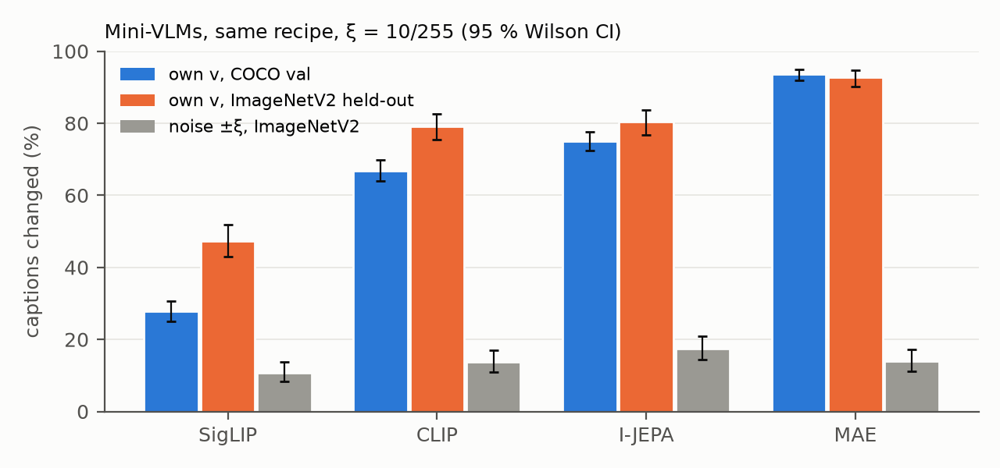
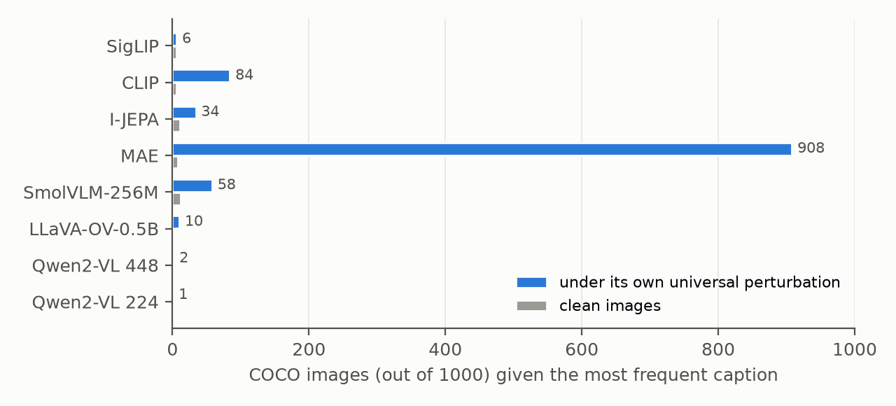
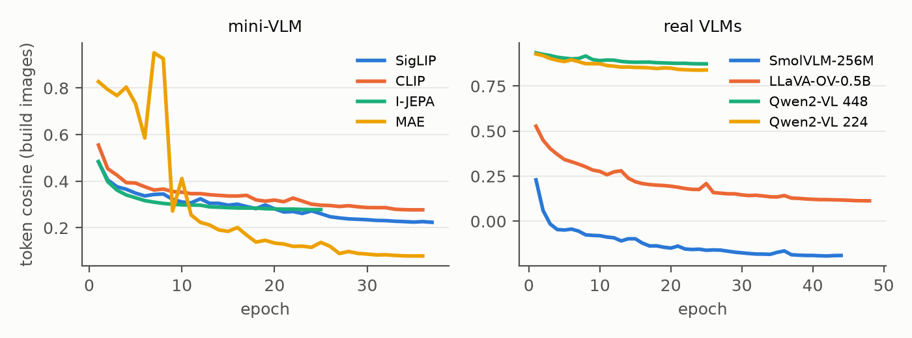
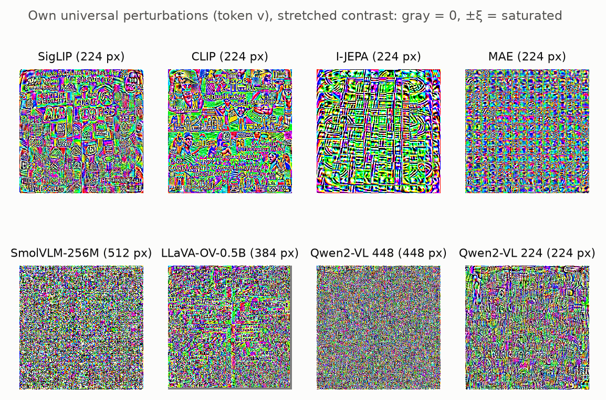
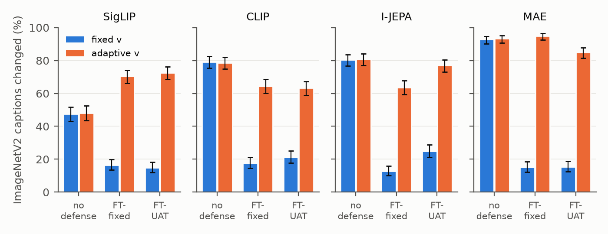
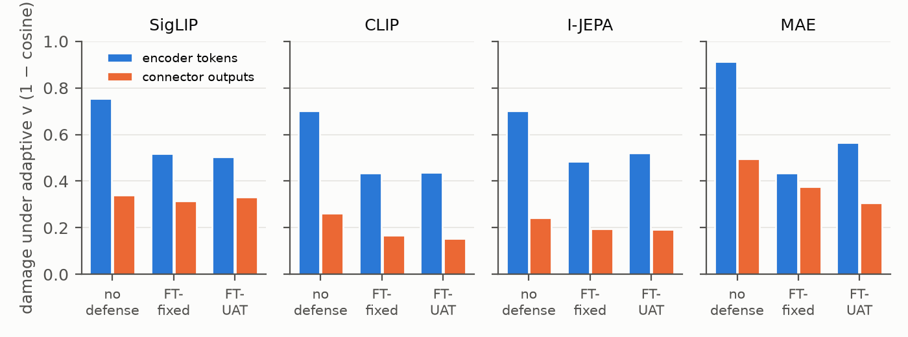
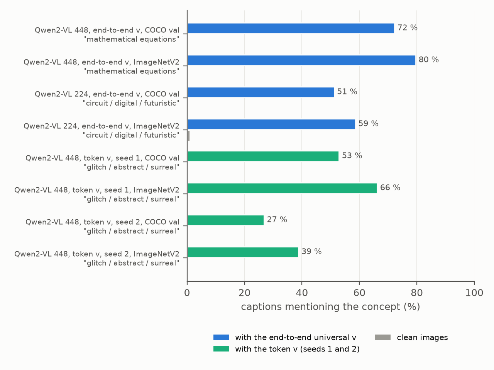
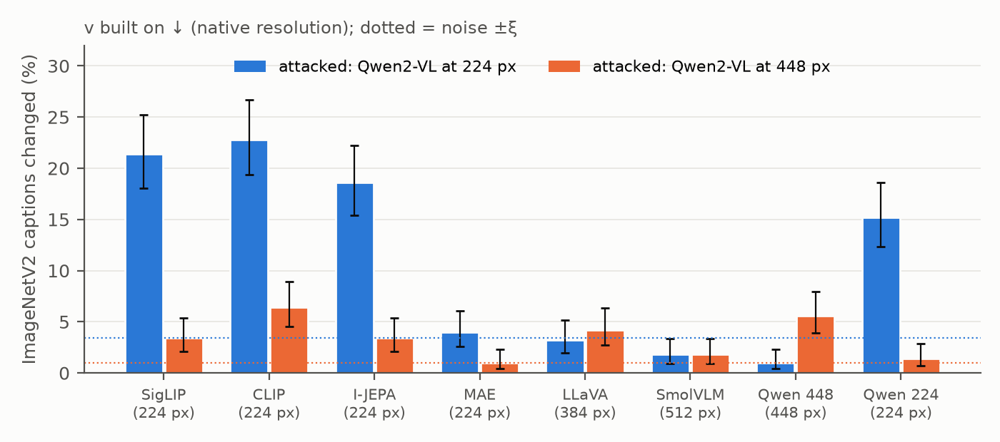
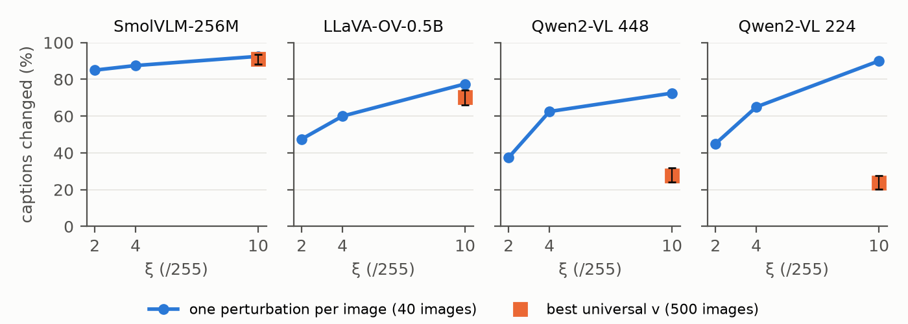

# Universal adversarial perturbations against vision-language models: role of the encoder, defenses, and real models

Experiment report: protocol, results ranked by confidence level, conclusions, audit and limitations.
Status as of the evening of 23 November 2026. Results that are still incomplete are grouped in Appendix C.
English version of RAPPORT.md (same content, same numbers).

---

## 0. Summary

We measure how much a **universal perturbation** v changes the captions produced by vision-language models (VLMs). A universal perturbation is a single additive pattern, with norm ‖v‖∞ ≤ 10/255, added to every image. Two families of models are studied:
- four **mini-VLMs** built with exactly the same recipe, which differ only in their frozen vision encoder (SigLIP, CLIP, I-JEPA, MAE);
- four configurations of pretrained **real VLMs**: SmolVLM-256M, LLaVA-OneVision-0.5B, and Qwen2-VL-2B at 448 and 224 px.

**Main conclusions:**

1. **Universal vulnerability depends strongly on the encoder.** With the same mini-VLM recipe, the model's own perturbation changes, on average over 3 attack seeds:

   | Encoder | COCO captions changed (mean over 3 seeds) |
   |---|---|
   | SigLIP | 31 % |
   | CLIP | 67 % |
   | I-JEPA | 77 % |
   | MAE | 94 % |

   The spread between seeds (at most 9 points) is much smaller than the gaps between encoders.
2. **A universal perturbation can control the output in two ways.**
   - **Replace** the caption: with the MAE v, 908 of 1000 COCO images receive exactly the same caption.
   - **Inject a concept or a style** without erasing the content: with Qwen2-VL, 72 % of COCO captions (80 % on ImageNetV2) start mentioning "mathematical equations", which appear in none of the clean captions.
   - An automatic search for injected words (Part IX) shows that injection is **general**: "baseball / team / logo" for LLaVA (53 % of captions), "book" for I-JEPA (up to 47 %), a "digital / glitch / abstract" effect for Qwen2-VL (up to 66 %).
3. **Qwen2-VL is not robust to universal perturbations**, contrary to what a first, poorly optimized attack suggested. Our main measure ("caption changed") strongly underestimates this injection mode of attack.
4. **Defense by fine-tuning the encoder:**
   - negligible cost on clean images;
   - effective against the fixed perturbation;
   - **ineffective against an adaptive attack**, and even **harmful for SigLIP**: 70.4 % of captions changed versus 48.0 % without defense, McNemar p ≈ 10⁻¹⁹.
   - Mechanism measured: the defense protects the encoder tokens, but not what the language model receives.
5. **One must take the maximum over several attack objectives and several attack seeds.**
   - The "end-to-end" attack on the caption is not an upper bound: for CLIP it is much weaker than the attack on the tokens (44.6 % versus 79.2 %).
   - On Qwen2-VL 448, three seeds of the same token attack change 5.6 %, 14.8 % and 13.4 % of captions (seed 0 versus each of the others: McNemar p < 10⁻⁷). Seeds 1 and 2 inject a "glitch / abstract / digital" style (66 % and 39 % of captions, versus 0.6 % for seed 0). The optimized cosine does not predict these differences (0.878, 0.872, 0.826).

**Main caveats:**
- the "caption changed" measure (MiniLM threshold 0.5) has not been validated by humans, and it does not see concept injection;
- transfers between models of different resolutions are confounded with the resizing of the perturbation;
- the code was not under version control during the campaign (§ 4).

---

## 1. Questions and common protocol

### 1.1 Questions

- **Q1.** Does the way the vision encoder was pretrained change a VLM's vulnerability to a universal perturbation, all else being equal?
- **Q2.** Which objective should be attacked (encoder tokens, connector outputs, caption)?
- **Q3.** Does a defense by fine-tuning the encoder resist an attacker who knows it, and how much does it cost on clean images?
- **Q4.** Do the conclusions hold for real pretrained VLMs?

### 1.2 Data

| Set | Content | Use | Code |
|---|---|---|---|
| ImageNetV2 matched-frequency | 10,000 images; sorted list, `np.random.RandomState(0).permutation`; first 500 = **build**, next 500 = **held-out** | The perturbation is built **only on build**; changed captions are measured on held-out | [common.py](common.py) `imagenetv2_split` |
| COCO train2017 | 118,287 images, 5 human captions each | Training of the mini-VLMs | `CocoCaptions` |
| COCO val2017 | The first 1000 images (sorted ids) | Quality (CIDEr) and attack against human captions; never seen in training | [eval_coco.py](eval_coco.py) |

**Preprocessing:**
- `Resize(short side) + CenterCrop`, no stretching;
- 224 px for the mini-VLMs; for the real VLMs, 512 (SmolVLM), 384 (LLaVA), 448 or 224 (Qwen2-VL);
- the field of view is the same everywhere;
- each perturbed image is **rounded to 8 bits** before being captioned.

Data download: [prepare_data.sh](prepare_data.sh).

### 1.3 Models

**Mini-VLMs** ([common.py](common.py), [train_connector.py](train_connector.py)):

| Frozen encoder (HF) | Pretraining | Size |
|---|---|---|
| `google/siglip-so400m-patch14-224` | image–text contrastive (sigmoid), WebLI | ~400M |
| `openai/clip-vit-large-patch14` | image–text contrastive (softmax), 400M pairs | ~300M |
| `facebook/ijepa_vith14_1k` | prediction in feature space, ImageNet-1k | ~630M |
| `facebook/vit-mae-huge` (no masking, patch order preserved) | pixel reconstruction, ImageNet-1k | ~630M |

The shared parts are:
- **Encoder:** ViT patch 14 at 224 px, i.e. 256 tokens; the CLS token is removed.
- **Connector:** LayerNorm, 2×2 pixel-shuffle (64 tokens), then a 2-layer MLP.
- **Language model:** SmolLM2-135M-Instruct.
- **Prompt:** "Describe this image in one sentence.".
- **Decoding:** greedy, at most 40 tokens.

Training is done on COCO train2017:

| Stage | What is trained | Epochs | Batch | Learning rate | Schedule |
|---|---|---|---|---|---|
| 1 | connector only | 1 | 64 | 1e-3 | 100-step warmup then cosine |
| 2 | connector + LoRA r = 16 on all projections | 1 | 32 | 2e-4 | 100-step warmup then cosine |

Other settings: AdamW, bf16, gradient clipping at 1, seed 0.

**siglip-unfrozen** variant ([run_unfrozen.sh](run_unfrozen.sh)): same stage 1 (copied), then a stage 2 in which the encoder is also trained (lr 2e-6).

**Real VLMs** ([real_vlm.py](real_vlm.py)): only native transformers classes, no remote code; bf16.

| Name | HF checkpoint | Encoder | Resolution | Attacked tokens |
|---|---|---|---|---|
| smolvlm-256m | HuggingFaceTB/SmolVLM-256M-Instruct | SigLIP-B/16 | 512, 1 view | 1024 × 768 |
| llava-ov-0.5b | llava-hf/llava-onevision-qwen2-0.5b-ov-hf | SigLIP-SO400M | 384; 2 identical views (anyres) | 729 × 1152 |
| qwen2-vl-2b | Qwen/Qwen2-VL-2B-Instruct | Qwen2-VL ViT (2D RoPE) | 448 | 1024 × 1280 (merger input) |
| qwen2-vl-2b-224 | same | same | 224 | 256 × 1280 |

The attack gradient flows through a **differentiable copy of the preprocessing**. This copy is checked at startup against the official processor: maximum difference 0.0000 for all four configurations (`sanity_check`, in the logs). Captions are produced by the **real pipeline**: 8-bit PIL image → processor → `generate`.

### 1.4 Attacks

All attacks go through `converge_uap` ([common.py](common.py)).

**Optimization:**
- Adam on v, then projection onto the ℓ∞ ball of radius ξ = 10/255;
- batch of 8;
- after each epoch, v is evaluated on the 500 build images (rounded to 8 bits), and the best v is kept;
- **plateau**: if the gain is below 0.001 for 2 epochs, restart from the best v with the step halved;
- **stop** after 3 halvings, at least 10 epochs (7 for the adaptive attack) and at most 60.

**Seeds:**
- seed 0 (original runs) starts from v = 0;
- seeds 1 and 2 (`--seed`) start from a random point in the ball and go through the images in a different order.

**Objectives:**

| Name | Objective minimized | Initial step | File |
|---|---|---|---|
| token v | mean cosine between clean and perturbed tokens | 1/255 | `uap_xi10.pt`, `uap_xi10_s{1,2}.pt` |
| connector v | cosine of the 64 connector outputs | 1/255 | `uap_conn_xi10.pt` |
| end-to-end v ("caption loss") | likelihood exp(−mean CE) of the model's own clean caption, through the whole model | 4/255 for the mini-VLMs; 1/255 for SmolVLM; **0.5/255 for Qwen2-VL** | `uap_cap_xi10.pt` |
| random noise | random sign ±ξ, **5 draws** | — | — |
| per image | sign PGD, 100 steps, α = 2.5ξ/100, same objective as the end-to-end v | — | [single_image.py](single_image.py) |

### 1.5 Metrics

| Metric | Definition | Remark |
|---|---|---|
| **changed** | MiniLM similarity (all-MiniLM-L6-v2) between the perturbed caption and the clean caption **of the same model** < 0.5 | main metric; taken from the earlier SmolVLM report; **does not see concept injection** (VI.2) |
| changed@0.7 | same with a threshold of 0.7 | too sensitive (§ 4.3): not used for conclusions |
| **wrong** | the best MiniLM similarity with the 5 human COCO captions is < 0.5 | measures whether the caption becomes false, not merely different |
| injection (concept) | share of captions that mention the injected concept (regular expression), compared with clean captions | used for Qwen2-VL (VI.2, VI.7); the concept is identified by reading the captions |
| injected words (automatic) | words present in ≤ 1 % of clean captions and ≥ 10 % of perturbed captions, same images, stop words removed | [injection_scan.py](injection_scan.py) (Part IX); thresholds set before looking at the result, but arbitrary |
| CIDEr | pycocoevalcap, corpus level, on 1000 COCO val images | **comparable only between conditions of the same model** (§ 4.4) |
| token / connector cosine | mean cosine of features, clean versus perturbed, on held-out images | 1 = unchanged |
| ImageNet accuracy read from the caption | the caption is matched by MiniLM to "a photo of a ⟨synonym⟩" for the 1000 classes; top-1 and top-5 | [imagenet_accuracy.py](imagenet_accuracy.py); measures how informative the caption is, not a classifier |

Statistics:
- each rate is given with a **95 % Wilson interval**;
- key comparisons on the same images use an **exact McNemar test** (binomial on discordant pairs). These tests were computed for this report from the caption files.

### 1.6 Execution and environment

- **Machines:** two school workstations, espagne and allemagne.
- **Environment** (recorded in `results/env_*.txt`):
  - NVIDIA RTX A4000 GPU (16 GB), driver 595.104, CUDA 13.2;
  - Python 3.9.25, torch 2.8.0, transformers 4.57.6, peft 0.17.1, sentence-transformers 5.1.2, pycocoevalcap 1.2.
- **Split** (according to the launch instructions):
  - espagne: mini-VLMs ijepa and clip, SmolVLM-256M, LLaVA;
  - allemagne: mini-VLMs mae and siglip, siglip-unfrozen, Qwen2-VL (448 and 224).
- **Storage:** data and weights on the local disk `/Data/...`; results in `results/<model>/` of the shared home, synchronized to the PC with rsync.

### 1.7 Traceability: from result to file

| Result | Script(s) | Command | Files produced |
|---|---|---|---|
| Training of the mini-VLMs | [train_connector.py](train_connector.py) | `./run_minivlm.sh <enc>` | `connector_stage{1,2}.pt`, `lora_stage2/`, `train_stage*_log.jsonl`, `log_train.txt` |
| Token v and connector v, token damage, transfers | [uap_encoder.py](uap_encoder.py) | `./run_converged.sh <enc>` | `uap_xi10.pt`, `uap_conn_xi10.pt`, `*_history.json`, `uap_xi10_tokens.json`, `log_uap.txt` |
| End-to-end v (mini-VLMs) | [uap_encoder.py](uap_encoder.py) `--target caption` | `./run_endtoend.sh`, `./run_complete.sh` | `uap_cap_xi10.pt`, `build_captions.json`, `uap_cap_xi10_tokens.json` |
| Attack seeds, noise draws | [uap_encoder.py](uap_encoder.py) / [real_vlm.py](real_vlm.py) `--seed k`, `common.extra_conditions` | `./run_complete.sh <machine>` | `uap_xi10_s{1,2}.pt`; conditions "seed k" and "random ±xi, draw k" |
| COCO captions (CIDEr, wrong, changed) | [eval_coco.py](eval_coco.py) | in the `run_*.sh` scripts | `coco_stage2.json`, `coco_captions_stage2.json` |
| ImageNetV2 held-out captions | [evaluate_captions.py](evaluate_captions.py) | same | `eval_captions_stage2_xi10.json`, `captions_stage2_xi10.json` |
| Defense and adaptive attack | [defense_finetune.py](defense_finetune.py) | in `run_converged.sh` | `defense_ft.json`, `defense_ft_captions.json`, `adaptive_xi10_*.pt`, `log_defense.txt` |
| Mechanism of the defense | [defense_mechanism.py](defense_mechanism.py) | `./run_complete.sh <machine>` | `defense_mechanism.json` |
| Unfrozen encoder | [train_connector.py](train_connector.py), [uap_encoder.py](uap_encoder.py) | `./run_unfrozen.sh siglip` | `results/siglip-unfrozen/` |
| SmolVLM with the v of the earlier report | [smolvlm_reference.py](smolvlm_reference.py) | `SMOLVLM=1 ./run_converged.sh ...` | `results/smolvlm/`, including `encoder_vs_original.json` |
| Real VLMs, token v | [real_vlm.py](real_vlm.py) | `./run_real_vlm.sh <model>` | `results/<model>/uap_xi10*.{pt,json}`, `coco_*`, `*captions*`, `log.txt` |
| Real VLMs, end-to-end v | [real_vlm.py](real_vlm.py) `--target caption --lr` | `./run_endtoend.sh`, `./run_complete.sh` | `uap_cap_xi10.pt`, `build_caption_ids.json` |
| Per-image attack | [single_image.py](single_image.py) | `./run_single.sh <model>` | `single_image.json`, `log_single.txt` |
| ImageNet accuracy read from captions | [imagenet_accuracy.py](imagenet_accuracy.py) | `python imagenet_accuracy.py` | `results/imagenet_accuracy.json` |
| Injected words (automatic search) | [injection_scan.py](injection_scan.py) | `python injection_scan.py` | `results/injection_scan.json` |
| Summary tables | [compare.py](compare.py) | `python compare.py` | `results/comparison.md` |
| Figures | [make_figures.py](make_figures.py) | `python make_figures.py --lang en` | `results/figures_en/*.png` |
| PDF of the report | [build_pdf.py](build_pdf.py) | `python build_pdf.py REPORT_EN.md` | `REPORT_EN.pdf` |

---

## 2. Results

**Confidence labels:**
- **[A] solid**: effect large compared with the controls (random noise, numerical floor, seed variance), disjoint intervals or McNemar p < 10⁻⁵, no critical dependence on an arbitrary choice.
- **[B] probable**: clear effect, but it depends on a choice (metric, resolution) or a control is missing.
- **[C] preliminary**: small sample, unpaired comparison, or effect close to the noise floor.

Within each part, results go from the most to the least certain.

**Noise floor to keep in mind:**
- 5 draws of ±ξ noise change on average 4.8 to 9.4 % of the mini-VLMs' COCO captions, and 11.1 to 17.4 % on ImageNetV2;
- for the real VLMs, they change 0.9 to 4.4 %;
- two numerically different pipelines of the same SmolVLM (fp32 versus bf16) already differ on 4.8 % (COCO) and 7.6 % (ImageNetV2) of captions (§ 4.3).

A gap of less than about 10 points is therefore interpretable only with a paired test.

### Part I: vulnerability by encoder (mini-VLMs, Q1)

Data: `results/{siglip,clip,ijepa,mae}/`. The perturbation is the model's own, optimized to convergence; only the "3 seeds" rows use the three seeds.

| | SigLIP | CLIP | I-JEPA | MAE |
|---|---|---|---|---|
| Clean CIDEr (COCO, 1000 images) | 1.175 | 1.020 | 0.909 | 0.919 |
| wrong, clean | 2.9 % (2–4) | 7.1 % (6–9) | 15.9 % (14–18) | 13.6 % (12–16) |
| **changed, own v, COCO, seed 0** | **27.8 %** (25–31) | **66.9 %** (64–70) | **75.1 %** (72–78) | **93.6 %** (92–95) |
| changed, own v, COCO, 3 seeds: mean [min–max] | 30.9 % [27.8–36.6] | 67.0 % [64.7–69.3] | 77.1 % [75.1–79.4] | 93.7 % [93.1–94.3] |
| changed, own v, ImageNetV2, 3 seeds | 48.4 % [45.6–52.2] | 79.4 % [77.8–81.2] | 81.5 % [80.4–83.2] | 93.3 % [92.6–94.4] |
| changed, ±ξ noise (5 draws), COCO / ImageNetV2 | 5.2 % / 11.1 % | 4.8 % / 13.8 % | 9.4 % / 17.4 % | 6.3 % / 15.3 % |
| wrong, own v (seed 0) | 21.6 % | 64.1 % | 75.0 % | 93.1 % |
| token cosine, own v (held-out) | 0.253 | 0.303 | 0.299 | 0.092 |
| distinct COCO captions under v (out of 1000) | 960 | 681 | 711 | **54** |

**I.1 [A]** SigLIP is clearly the least vulnerable and MAE the most vulnerable.
- The ranges covered by the 3 seeds do not overlap between SigLIP, the CLIP / I-JEPA group, and MAE.
- Captions do not just change: they become **false** ("wrong" follows "changed").
- The variance due to the attack is small (at most 9 points, for SigLIP) compared with the gaps between encoders (30 to 60 points).

**I.2 [A]** With MAE, the universal perturbation **imposes an almost unique caption**. 908 of the 1000 COCO images receive "A group of people standing next to each other.", and only 54 distinct captions remain. CLIP shows a weaker form of the same phenomenon: the same caption 84 times. This is the text-generation equivalent of the "dominant class" of universal perturbations on classifiers.

**I.3 [B]** Damage to the tokens is not enough to predict damage to the captions. SigLIP, CLIP and I-JEPA have comparable token cosines (0.25 to 0.30), but 28 to 75 % of captions changed. SigLIP's connector and language model seem to ignore a large part of the destroyed directions (see also II.2 and IV.3).

**I.4 [B]** The gap between CLIP and I-JEPA is clear only on COCO. On ImageNetV2, their seed ranges touch (79.4 % versus 81.5 %). The ranking between these two also depends on the optimization effort:

| | COCO, 10 epochs | COCO, convergence |
|---|---|---|
| SigLIP | 20.7 % | 27.8 % |
| CLIP | 50.6 % | 66.9 % |
| I-JEPA | 70.5 % | 75.1 % |
| MAE | 57.4 % | 93.6 % |

At 10 epochs, MAE even looked less vulnerable than I-JEPA (`results/old_10epochs/`). Figure 6 shows why. For 9 epochs, the attack on MAE oscillates between 0.6 and 0.95 cosine. It then collapses abruptly (0.27 at epoch 9), and goes down to 0.08. **An attack stopped too early can reverse a ranking.**

**I.5 [B]** The universal perturbations of SigLIP and CLIP contain readable **typographic patterns and faces** (Figure 7): words ("AIR", "Australia"), logos, portraits. Those of I-JEPA and MAE are periodic textures, at the scale of the 14 px patch for MAE. This is consistent with image–text pretraining, where text written in the image is a strong signal. It is a qualitative observation, not a measurement.

**I.6 [C]** The difference cannot be attributed to the pretraining **objective** alone. The encoders also differ in size, data and the clean quality obtained: CIDEr from 0.91 to 1.18, clean wrong from 2.9 % to 15.9 %. The cleanest pair is I-JEPA / MAE (same ViT-H/14 architecture, same ImageNet-1k data): 77 % versus 94 % over 3 seeds, which suggests an effect of the objective (predicting features rather than reconstructing pixels). But there is only one connector training per encoder.

### Part II: which objective to attack? (Q2)

ImageNetV2 held-out captions changed, by attack objective (seed 0):

| | SigLIP | CLIP | I-JEPA | MAE | SmolVLM-256M | Qwen2-VL 448 | Qwen2-VL 224 |
|---|---|---|---|---|---|---|---|
| token v | 47.4 % | **79.2 %** | **80.4 %** | 92.8 % | **91.2 %** | 5.6 % | 15.2 % |
| connector v | 44.4 % | 50.8 % | 77.4 % | 74.8 % | — | — | — |
| end-to-end v | **48.4 %** | 44.6 % | 70.4 % | **93.4 %** | 63.6 % | **27.8 %** | **23.8 %** |

**II.1 [A]** **No objective dominates.** The token attack is the best for CLIP, I-JEPA and SmolVLM. The end-to-end attack is the only effective one on Qwen2-VL. For CLIP, the gap is massive: 44.6 % versus 79.2 %, McNemar 15 versus 188 discordant pairs, p ≈ 3·10⁻³⁹.

Optimizing a universal perturbation is not convex, and different objectives find different optima. The CLIP token v produces a dominant caption; the end-to-end v does not. **To measure a vulnerability, one must keep the maximum over several attacks.**

**II.2 [A]** For SigLIP, the three objectives plateau at the same level: 44 to 48 %, tokens / end-to-end difference not significant (p = 0.76). This is the strongest evidence that its resistance does not come from a poor choice of objective.

**II.3 [B]** A near-zero likelihood of the clean caption does not guarantee a change of meaning. For SmolVLM, the end-to-end v drops this likelihood to 0.001 on the build images, but changes only 63.6 % of held-out captions, versus 91.2 % for the token v. The model can make the exact caption improbable while keeping its meaning.

**II.4 [B]** Targeting the connector outputs, i.e. what the language model receives, is never better than targeting the tokens. Nothing explains why.

### Part III: transfer between mini-VLMs

Rate of COCO captions changed. Rows give the model v was built on, columns the attacked model. All v are at 224 px, so **no resizing**.

| v built on ↓ / attacked → | SigLIP | CLIP | I-JEPA | MAE |
|---|---|---|---|---|
| SigLIP | (27.8 %) | 14.0 % | 14.1 % | 17.6 % |
| CLIP | 16.7 % | (66.9 %) | 12.2 % | 17.2 % |
| I-JEPA | 10.6 % | 10.8 % | (75.1 %) | **27.3 %** |
| MAE | 7.1 % | 6.5 % | 11.7 % | (93.6 %) |
| SmolVLM (earlier report, 512 → 224) | 2.8 % | 4.2 % | 5.3 % | 4.4 % |
| ±ξ noise (5 draws) | 5.2 % | 4.8 % | 9.4 % | 6.3 % |

**III.1 [A]** Transfer is weak: 6.5 to 17.6 %, versus 4.8 to 9.4 % for noise. There is one exception: **I-JEPA → MAE, 27.3 %**, the pair with the same architecture and the same data. Transfer is asymmetric: MAE → I-JEPA gives only 11.7 %. MAE, the most vulnerable, is also the easiest target for all transfers.

**III.2 [B]** The SmolVLM v of the earlier report does not transfer (2.8 to 5.3 %). But it is **downscaled from 512 to 224 px** with anti-aliasing, which erases its fine details (VI.5). This result therefore says nothing about its real transferability.

### Part IV: defense by fine-tuning the encoder (Q3)

**Recipe** ([defense_finetune.py](defense_finetune.py), taken from notebook 07):
- the whole encoder is tuned on the 500 build images, for 3 epochs (Adam, lr 1e-5, batch 8);
- the loss anchors the perturbed tokens **and** the clean tokens to the original tokens: 1 − cos;
- the connector and the language model are not retrained;
- **FT-fixed** defends against the fixed v; **FT-UAT** follows Shafahi et al. 2020, with one Adam step on v after each encoder step;
- the adaptive attack is a new v, initialized with the original v and optimized to convergence against the tuned encoder;
- **no-defense** applies the same adaptive procedure to the original encoder: it is the reference at equal attack effort.

In each cell, the first value is COCO and the second ImageNetV2 held-out (captions changed).

| | SigLIP | CLIP | I-JEPA | MAE |
|---|---|---|---|---|
| Clean CIDEr: original → FT-fixed / FT-UAT | 1.175 → 1.170 / 1.174 | 1.020 → 1.006 / 1.002 | 0.909 → 0.906 / 0.900 | 0.919 → 0.925 / 0.925 |
| Clean cost (captions changed vs the original model), FT-fixed | 2.0 % / 5.8 % | 4.2 % / 11.6 % | 2.9 % / 8.2 % | 2.0 % / 3.4 % |
| no-defense, fixed v | 27.8 % / 47.4 % | 66.9 % / 79.2 % | 75.1 % / 80.4 % | 93.6 % / 92.8 % |
| FT-fixed, fixed v | 6.9 % / 16.4 % | 7.9 % / 17.6 % | 7.8 % / 12.8 % | 7.1 % / 15.2 % |
| no-defense, adaptive v | 28.7 % / **48.0 %** | 69.4 % / **78.6 %** | 75.5 % / **80.8 %** | 93.6 % / **93.2 %** |
| FT-fixed, adaptive v | 64.6 % / **70.4 %** | 53.0 % / 64.4 % | 57.3 % / 63.6 % | 96.4 % / 94.8 % |
| FT-UAT, adaptive v | 67.8 % / **72.6 %** | 51.6 % / 63.2 % | 76.2 % / 77.0 % | 85.1 % / 85.0 % |

McNemar tests on ImageNetV2, adaptive v, defense versus no-defense:

| | SigLIP | CLIP | I-JEPA | MAE |
|---|---|---|---|---|
| FT-fixed | **worse**, p ≈ 2·10⁻¹⁹ | better, p ≈ 2·10⁻⁹ | better, p ≈ 4·10⁻¹³ | not significant, p = 0.24 |
| FT-UAT | **worse**, p ≈ 3·10⁻²¹ | better, p ≈ 10⁻¹¹ | not significant, p = 0.07 | better, p ≈ 2·10⁻⁶ |

**IV.1 [A]** The clean cost is **negligible**.
- CIDEr moves by less than 0.02, and clean "wrong" stays within the original interval.
- The 3.4 to 11.6 % of ImageNetV2 captions that change are of the same order as random noise (11 to 17 %).
- ImageNet accuracy read from the captions does not drop (SigLIP: 14.4 % → 15.0 % top-1).

What follows therefore does **not** come from a degraded model.

**IV.2 [A]** Against the **fixed** v, the defense works. COCO captions changed drop from 28–94 % to about 7–8 %, close to random noise.

**IV.3 [A]** Against an **adaptive** attacker, the defense does not hold. For **SigLIP, it makes things worse**: 70.4 to 72.6 % of ImageNetV2 captions changed, versus 48.0 % without defense.

**IV.4 [B] Measured mechanism** ([defense_mechanism.py](defense_mechanism.py), Figure 9). Under the adaptive v, we measure separately the damage to the encoder tokens and the damage to the connector outputs, which are what the language model receives.

| Cosine under adaptive v (tokens / connector) | SigLIP | CLIP | I-JEPA | MAE |
|---|---|---|---|---|
| no-defense | 0.246 / 0.660 | 0.299 / 0.736 | 0.298 / 0.756 | 0.087 / 0.504 |
| FT-fixed | 0.482 / 0.685 | 0.565 / 0.832 | 0.515 / 0.804 | 0.566 / 0.625 |
| FT-UAT | 0.496 / 0.667 | 0.563 / 0.846 | 0.479 / 0.806 | 0.435 / 0.694 |

- **For all four encoders,** the defense roughly halves the damage to the **tokens**.
- **For SigLIP,** the damage to the **connector outputs** stays the same (0.66 → 0.67–0.69). The adaptive attacker has moved its effort to the directions the connector passes on. Protecting the encoder does not protect what the language model reads.
- **For CLIP and I-JEPA,** the connector is somewhat better protected (0.74 → 0.83–0.85; 0.76 → 0.80), and fewer captions change. This is consistent.
- **The connector cosine does not explain everything.** For SigLIP, equal damage at the connector produces **more** changed captions (70 % versus 48 %). For I-JEPA, FT-fixed and FT-UAT have the same connector cosine (0.80) but 64 % versus 77 % of captions changed. The language model is more sensitive to some directions than to others, and a mean cosine does not capture this.

**IV.5 [B]** For CLIP and I-JEPA (FT-fixed), the adaptive gain is real but modest: about 15 points. FT-UAT is no better than FT-fixed, although the literature presents it as the robust version. With 3 epochs on 500 images, the UAT adversary may not have had time to become strong. This is a lack of budget, not a conclusion about UAT.

**IV.6 [B]** The adaptive attacks against the defended encoders ran longer (19 to 51 epochs) than no-defense (9 to 13 epochs, starting from an already converged v). The stopping criterion is the same.

### Part V: post-training with an unfrozen encoder (SigLIP only)

| | SigLIP frozen | SigLIP unfrozen |
|---|---|---|
| Clean CIDEr | 1.175 | 1.200 |
| v of the original encoder (fixed), COCO / ImageNetV2 | 27.8 % / 47.4 % | 24.1 % / 43.6 % |
| recomputed v (tokens) | 27.8 % / 47.4 % | 22.5 % / 42.8 % |
| recomputed v (connector) | 25.7 % / 44.4 % | 19.9 % / 37.8 % |

**V.1 [C]** Unfreezing the encoder does not make the model more vulnerable. Given SigLIP's seed variance (27.8 to 36.6 % on COCO), the observed gap (22.5 % versus 27.8 %) is not significant. Only one encoder was tested.

### Part VI: real VLMs, universal perturbations (Q4)

| | SmolVLM-256M | LLaVA-OV-0.5B | Qwen2-VL 448 | Qwen2-VL 224 |
|---|---|---|---|---|
| clean wrong (COCO) | 23.9 % | 5.8 % | 1.6 % | 4.7 % |
| ImageNet top-1 accuracy read from the caption (clean) | 14.8 % | 36.4 % | 42.8 % | 41.2 % |
| changed, ±ξ noise (5 draws), COCO / ImageNetV2 | 2.1 % / 4.4 % | 2.1 % / 2.2 % (1 draw) | 0.9 % / 1.4 % | 2.4 % / 3.4 % |
| changed, token v, COCO / ImageNetV2 | **88.2 % / 91.2 %** | **60.9 % / 70.2 %** | 2.2 % / 5.6 % | 10.7 % / 15.2 % |
| changed, token v, seeds, ImageNetV2 | 3 seeds: 92.6 % [91.2–93.4] | Appendix C | **3 seeds: 5.6 %, 14.8 %, 13.4 %** | 3 seeds: 17.7 % [15.2–21.4] |
| changed, end-to-end v, COCO / ImageNetV2 | 58.7 % / 63.6 % | Appendix C | 18.6 % / **27.8 %** | 16.5 % / **23.8 %** |
| **captions with the injected concept** (end-to-end v), COCO / ImageNetV2 | — | — | **72 % / 80 %** | **51 % / 59 %** |
| captions with the "glitch / abstract / surreal" style (token v), COCO / ImageNetV2 | — | — | seed 0: 0.4 % / 0.6 %; **seed 1: 53 % / 66 %; seed 2: 27 % / 39 %** | see IX |
| token cosine, token v / end-to-end v | −0.078 / — | 0.168 / — | 0.878 / 0.931 | 0.849 / 0.919 |
| ImageNet top-1 accuracy under end-to-end v | 12.8 % | — | 34.6 % | 31.8 % |

**VI.1 [A]** SmolVLM-256M and LLaVA-OV are very vulnerable to their own universal perturbation: 88 to 93 % and 61 to 70 % of captions change. These captions are false (wrong 93.7 % and 58.9 %). The v of the earlier report, applied to SmolVLM-256M at 512 px without resizing, changes 90.5 % of COCO captions. This matches the earlier report.

**VI.2 [A] Qwen2-VL is not robust to universal perturbations: the perturbation makes it see an object that does not exist.**

With a suitable optimization step (0.5/255, 47 epochs), the end-to-end v of Qwen 448 changes 27.8 % of ImageNetV2 captions according to our metric. This is much more than the token v (5.6 %, McNemar 118 versus 7, p ≈ 4·10⁻²⁷). Above all, the captions show an **injection** mode of attack:

- "A blue jay perches on a branch amidst lush green foliage." → "A blue jay perched on a tree branch **with mathematical equations and symbols floating around**…"
- "A close-up of a snake's head…" → "The image features a python **with mathematical equations and symbols floating around it**…"

**72 % of COCO captions and 80 % of ImageNetV2 captions** mention mathematical equations, versus **0** without perturbation. At 224 px, the concept is "circuit / digital / futuristic": 51 % and 59 %, versus 0.2 and 1 % without perturbation.

Qwen still describes the main subject, but the attacker controls part of every caption. The "changed" metric counts only captions whose **overall meaning** changes, and therefore strongly underestimates this mode of attack. The encoder tokens are barely modified (cosine 0.93, versus 0.95 for noise). A feature-level measurement would see nothing.

**VI.3 [A, methodologically]** The first conclusion "Qwen2-VL is robust to universal perturbations" came from a **poorly optimized attack**:
- a first run with a step of 4/255, stopped after 23 epochs (score 0.36), gave only 7.8 % of captions changed;
- the run with a step of 0.5/255 reaches a score of 0.19 and 27.8 %, with 80 % injection.

This is the same trap as in I.4: **concluding robustness requires an attack that has been checked to have gone all the way.**

**VI.4 [C]** We cannot conclude that high resolution protects.
- With the token objective, seed 0 made Qwen 224 look more vulnerable than Qwen 448 (15.2 % versus 5.6 %). But seeds 1 and 2 of Qwen 448 reach 14.8 % and 13.4 %, close to the range of Qwen 224's 3 seeds (15.2 to 21.4 %; means over 3 seeds: 11.3 % versus 17.7 %). The gap came largely from seed 0 (VI.7).
- With the end-to-end objective, the order is reversed (23.8 % versus 27.8 %, unpaired comparison, a single seed).

**VI.5 [A, methodologically]** Transfers between different resolutions are **dominated by resizing**.
- The Qwen 448 token v, downscaled to 224 px, changes only **1.0 %** of the captions of the **same model** at 224 px, as much as noise.
- All downscaled v (448, 384 or 512 → 224) fall to the noise level (1.0 to 3.2 %).
- The 224 px v upscaled to 448 fall to 1 to 6 %.

The transfer tables between real VLMs therefore do not measure transferability.

**VI.6 [B]** v computed on mini-VLMs at 224 px (CLIP, SigLIP, I-JEPA) fool Qwen2-VL 224 at least as well as its own token v (18.6 to 22.8 %, versus 15.2 to 21.4 % over 3 seeds). The MAE v does not transfer (4.0 %). So this is not a generic effect of 224 px perturbations.

**VI.7 [B] On Qwen2-VL 448, the attack seed changes the result, and even the mode of attack.** Seeds 1 and 2 of the token v ([real_vlm.py](real_vlm.py) `--seed 1` / `--seed 2`, random start in the ball; seed 1: 30 epochs, epoch 29 kept; seed 2: 49 epochs, epoch 49 kept):

| Qwen 448 token v | seed 0 | seed 1 | seed 2 |
|---|---|---|---|
| token cosine, build / held-out | 0.873 / 0.878 | 0.864 / 0.872 | 0.814 / 0.826 |
| changed, COCO | 2.2 % | 8.4 % | 7.2 % |
| changed, ImageNetV2 | 5.6 % (3.9–8.0) | **14.8 %** (12.0–18.2) | **13.4 %** (10.7–16.7) |
| captions with "glitch / abstract / surreal / pixelated / distorted", COCO / ImageNetV2 | 0.4 % / 0.6 % | **52.9 % / 66.2 %** | **26.8 % / 38.8 %** |
| ImageNet top-1 accuracy read from the caption (clean: 42.8 %) | 38.6 % | 36.8 % | 37.4 % |

- **Seed 0 is the outlier.** On the same images, seeds 1 and 2 each differ significantly from seed 0: McNemar 12 versus 58 discordant pairs on ImageNetV2 (p ≈ 2·10⁻⁸) and 11 versus 73 on COCO (p ≈ 2·10⁻¹²) for seed 1; 8 versus 47 (p ≈ 8·10⁻⁸) and 11 versus 61 (p ≈ 2·10⁻⁹) for seed 2. Seeds 1 and 2 do not differ from each other: 36 versus 29 (p = 0.46) and 55 versus 43 (p = 0.27).
- Seeds 1 and 2 **inject a style**: "The image features a banana and a donut **with a glitch effect applied**…" (seed 1), "A blue jay perches on a branch amidst green foliage, **with a digital glitch effect applied to the image**" (seed 2). The content often stays correct, as with the injection of equations (VI.2). The automatic search finds "abstract / effect / surreal / glitchy" for seed 1 and "digital / abstract / effect" for seed 2 (Part IX).
- **The optimized score does not predict the captions.** Seeds 0 and 1 have almost the same cosine (0.878 versus 0.872) and very different effects. Seed 2 reaches the best score of the three (0.826), but changes slightly fewer captions than seed 1 and injects the style less often (39 % versus 66 %). Neither the token cosine nor "changed" measures what the attacker obtains.
- Over 3 seeds, the token v changes 11.3 % of ImageNetV2 captions and 5.9 % of COCO captions on average. A single seed (seed 0) underestimated the vulnerability by a factor of about 2.5. For the mini-VLMs, the gap between seeds is at most 9 points (I.1); for Qwen 448 it is 9 points in "changed", but 66 points in injection. Three seeds remain too few to know the distribution.
- Seeds 1 and 2 were evaluated by the same code and on the same images as seed 0. Only the starting point and the order of the images differ.

### Part VII: universal perturbation versus per-image perturbation

Per-image attack ([single_image.py](single_image.py)): 100-step PGD, same objective as the end-to-end v, on the first 40 ImageNetV2 held-out images. Wilson intervals are given in brackets.

| ξ | SmolVLM-256M | LLaVA-OV-0.5B | Qwen2-VL 448 | Qwen2-VL 224 |
|---|---|---|---|---|
| 2/255 | 85.0 % [71–93] | 47.5 % [33–63] | 37.5 % [24–53] | 45.0 % [31–60] |
| 4/255 | 87.5 % [74–95] | 60.0 % [45–74] | 62.5 % [47–76] | 65.0 % [50–78] |
| 10/255 | 92.5 % [80–97] | 77.5 % [62–88] | 72.5 % [57–84] | 90.0 % [77–96] |
| Best universal v, **same 40 images**, 10/255 | 85.0 % | 60.0 % | 30.0 % | 17.5 % |

**VII.1 [B]** All models can be fooled image by image with a small budget: at least 37.5 % of captions change from 2/255. In terms of "changed", the gap between per-image and universal perturbation is small for SmolVLM and LLaVA, but large for Qwen2-VL (×2.4 at 448 px, ×5 at 224 px). This is not true robustness: on Qwen, the universal v injects a concept rather than replacing the caption (VI.2), and the metric does not count this case.

**VII.2 [B]** The objective "make the exact caption improbable" underestimates the change of meaning. For LLaVA at 10/255, the likelihood of the clean caption drops to 0.008, but 22.5 % of the captions remain paraphrases. The per-image rates are **lower bounds**: 100 steps, no restarts, with an objective that is not semantic.

**VII.3 [C]** With 40 images, the intervals are about ±15 points. Differences between models under the per-image attack are not interpretable.

### Part VIII: ImageNet accuracy read from the captions

Values are top-1 on 500 held-out images, with a 95 % interval of about ±4 points.

| | clean | token v | end-to-end v | noise (draw 0) |
|---|---|---|---|---|
| SigLIP | 14.4 % | 9.2 % | 7.8 % | 15.0 % |
| CLIP | 7.6 % | 3.4 % | 4.8 % | 8.0 % |
| I-JEPA | 5.2 % | 1.8 % | 4.0 % | 4.4 % |
| MAE | 5.0 % | 0.4 % | 1.0 % | 5.6 % |
| SmolVLM-256M | 14.8 % | 1.0 % | 12.8 % | 14.4 % |
| LLaVA-OV | 36.4 % | 11.0 % | — | 35.2 % |
| Qwen2-VL 448 | 42.8 % | 38.6 % | 34.6 % | 43.6 % |
| Qwen2-VL 224 | 41.2 % | 31.2 % | 31.8 % | 37.6 % |

Qwen2-VL 448, token v of seeds 1 and 2: 36.8 % and 37.4 % top-1 (51.4 % and 51.8 % top-5).

**VIII.1 [B]** This measure confirms the rankings of Parts I, II and VI with a metric independent of the 0.5 threshold. For Qwen 448, it is consistent with injection: the class is still often named (34.6 to 38.6 % versus 42.8 %), while a foreign concept or style is added. The absolute values cannot be compared with a classifier, because the mini-VLMs, trained on COCO's generic captions, rarely name the ImageNet class.

### Part IX: systematic search for injected words

The concept injected into Qwen (VI.2) was found by reading the captions. To avoid depending on this reading, [injection_scan.py](injection_scan.py) searches, for each own perturbation, for words present in **at most 1 %** of clean captions and **at least 10 %** of perturbed captions (same images, stop words removed). Transfers and noise are excluded. The table gives the results on ImageNetV2 held-out (500 images); "at least one word" is the share of captions containing at least one of the words found.

| Model | Perturbation | At least one word (ImageNetV2 / COCO) | Injected words (share of ImageNetV2 captions) | Type |
|---|---|---|---|---|
| Qwen2-VL 448 | end-to-end v | 81 % / 73 % | mathematical 79 %, equations 75 %, symbols 56 %, floating 31 % | concept |
| Qwen2-VL 448 | token v, seed 0 | 0 % / 0 % | none | — |
| Qwen2-VL 448 | token v, seed 1 | 68 % / 56 % | abstract 37 %, effect 24 %, surreal 22 %, glitchy 19 % | style |
| Qwen2-VL 448 | token v, seed 2 | 46 % / 27 % | digital 33 %, abstract 31 %, effect 15 % | style |
| Qwen2-VL 224 | end-to-end v | 60 % / 53 % | circuit 49 %, board 47 %, futuristic 25 %, digital 18 % | concept |
| Qwen2-VL 224 | token v, seeds 0 / 1 / 2 | 39 / 45 / 43 % | digital 21–39 %, abstract 17–26 %, overlay 11 % | style |
| LLaVA-OV | token v | 77 % / 45 % | baseball 53 %, split 34 %, team 31 %, screen 22 %, logo 22 % | concept |
| SmolVLM | end-to-end v | 46 % / 40 % | year 23 %, painting 17 %, picture 14 % | concept / framing |
| SmolVLM | token v, 3 seeds | 0 to 10 % | (isolated words: "o", "again") | — |
| MAE | end-to-end v | 82 % / 64 % | bathroom 54 %, number 35 %, designs 25 %, tubs 19 % | concept (dominant caption) |
| MAE | token v, seeds 0 / 1 / 2 | 87 / 23 / 81 % | other, each ("…next to each other") | dominant caption |
| I-JEPA | token v, seeds 0 / 1 / 2 | 13 / 20 / 47 % | book 13 / 20 / 47 % | concept |
| I-JEPA | end-to-end v | 29 % / 26 % | door 25 %, frame 11 % | concept |
| CLIP | token v, seed 1 | 35 % / 23 % | flag 23 %, sign 15 % | concept |
| CLIP | end-to-end v | 26 % / 17 % | birds 26 % | concept |
| CLIP | connector v | 41 % / 0 % | screen, keyboard, laptop, mouse 11–15 % | concept |
| SigLIP | token v, 3 seeds | 36 / 38 / 51 % | picture 36–45 % ("A picture of…") | framing |

Examples (clean → perturbed):
- LLaVA: "A Mexican flag is waving in the wind…" → "A side view of a **baseball team with a logo** on it."
- Qwen 224, token v: "A blue jay perches on a branch…" → "A blue jay perches on a tree branch, **surrounded by a digital overlay of grid lines and dots**."
- MAE, end-to-end v: "A man wearing a red shirt and a white tie." → "**A bathroom with a lot of different colored tubs.**"

**IX.1 [B]** **Injection is the general case, not a peculiarity of Qwen.** The search covers 33 own perturbations; the table groups them, and the full list is in `results/injection_scan.json`. On ImageNetV2:
- only 3 inject no word (Qwen 448 seed 0, MAE connector, SmolVLM seed 2);
- 2 others inject only lexical noise (SmolVLM seeds 0 and 1);
- the other 28 make one or more foreign words appear in at least 10 % of captions.

We distinguish three modes:
- **replacement** by a dominant caption (MAE, token v);
- **injection of a concept** that adds to the content or partly replaces it (LLaVA "baseball team", Qwen "equations", I-JEPA "book");
- **injection of a style** that leaves the content intact (Qwen "digital / glitch / abstract").

**IX.2 [B]** The injected concept depends on the seed and on the objective, but it is sometimes **stable**: "book" for the 3 seeds of I-JEPA, "digital" for the 3 seeds of Qwen 224, "picture" for the 3 seeds of SigLIP. It varies between seeds for Qwen 448 (nothing for seed 0, a "glitch / abstract" or "digital / abstract" style for seeds 1 and 2) and CLIP ("number / each", then "flag").

**IX.3 [C]** The link with the text and faces seen in the SigLIP and CLIP perturbations (I.5) is not established. For SigLIP, the injected word ("picture") is a **framing** word, not an object: the model describes the image as a picture. This is not necessarily a useful attack.

**Limits of this measure.** The thresholds (1 % and 10 %) are arbitrary, but they were set before looking at the result. The measure works at the word level: it sees neither paraphrases nor a concept expressed with varied words. It counts the words of a dominant caption as "injected" (MAE). The classification into "concept", "style" or "framing" is done by hand. For SmolVLM, the words found for the token v ("o", "again") are lexical noise: its perturbed captions are false but varied.

---

## 3. Conclusions

### 3.1 What can be claimed

| Conf. | Conclusion | Evidence |
|---|---|---|
| A | With the same recipe, the encoder determines universal vulnerability: SigLIP ≪ CLIP ≈ I-JEPA < MAE | I.1: 3 seeds, disjoint intervals |
| A | A universal perturbation controls the output, either by **replacing** the caption (MAE: 908/1000 identical), or by **injecting** a concept (Qwen2-VL: 72–80 % of captions) | I.2, VI.2 |
| B | Injection of a concept or a style is the general case: 28 of 33 own perturbations make words absent from the clean captions appear | IX.1 |
| B | On Qwen2-VL 448, three seeds give 5.6 %, 14.8 % and 13.4 % of captions changed, and 0.6 %, 66 % and 39 % style injection; the optimized score does not predict these differences | VI.7 |
| A | None of the real VLMs tested is robust to universal perturbations | VI.1, VI.2 |
| A | Defense by fine-tuning the encoder: negligible clean cost, effective against the fixed v, ineffective against the adaptive v, **harmful for SigLIP** | IV.1 to IV.3, McNemar |
| A | No attack objective dominates; a poorly optimized attack leads to wrongly concluding robustness | II.1, I.4, VI.3 |
| A | Transfers between different resolutions are confounded with resizing | VI.5 |
| B | The defense protects the encoder, but not what the language model reads (SigLIP) | IV.4 |
| B | Perturbations of image–text encoders contain text and faces | I.5 |
| C | Specific effect of the pretraining objective (I-JEPA versus MAE); unfrozen encoder; effect of resolution | I.6, V.1, VI.4 |

### 3.2 Methodological lessons

1. **Measure an attack at convergence, with several objectives and several seeds.** Three conclusions of this work were reversed or weakened when the attack was better optimized or repeated: MAE at 10 epochs, Qwen2-VL with too large a step, and the effect of resolution on Qwen (VI.4, VI.7).
2. **The metric must see the mode of attack.** "Changed" detects replacement of the caption, not the injection of a concept or a style. The optimized score (token cosine) does not see it either. A complete evaluation must also measure what the attacker adds (Part IX).
3. **Evaluate a defense against an adaptive attacker, measuring what the language model reads**, not only the encoder tokens.
4. **Only compare transfers at equal resolution.**

---

## 4. Audit: doubts about how the experiments ran

### 4.1 Code reproducibility

- **The `smol_exp/` folder is not tracked by git** (`git status`: `?? smol_exp/`). No result is tied to a version of the code. The commit recorded in `env_*.txt` (2e5ab15) is that of the parent repository, which does not contain this code.
- **The code changed during the campaign.** The logs of the first token attacks print "feature cosine on the build images", whereas the current code prints "score on the build images". `converge_uap` was then generalized (adding `score_fn`, then `seed`). By construction, the default behavior is unchanged (seed 0 reproduces the original image order), but **this has not been verified by a re-run**.
- **Software versions:** recorded only since 22 November (`env_*.txt`). Earlier runs very probably used the same venv, but this is not proven.

### 4.2 Execution incidents (checked in the logs)

| Incident | Effect on the results |
|---|---|
| Out-of-memory errors (OOM) at the start of I-JEPA and MAE training, relaunched with gradient accumulation (micro-batches of 16) | Same gradient up to bf16 rounding. After a resume, the image order is restored, but not the draw of the human caption. Negligible effect expected |
| Qwen2-VL 448 OOM during evaluation, then during backward | Fixed (batched evaluation, per-block checkpointing) before the run kept, which does start from "start 1.0000". No effect |
| SmolVLM-256M: first attempt with a preprocessing gap of 0.0784 | The run **stopped on the assertion** before any attack. The run kept has a gap of 0.0000 |
| LLaVA: 2 views per image | The assertion was relaxed after checking that the 2 views are identical. The attack perturbs both views in the same way |
| Qwen 448 end-to-end: first run with a step of 4/255 (7.8 %) | Replaced by the run at 0.5/255; the old v was archived in `results/qwen2-vl-2b/old_lr4/` on the school machine (VI.3) |
| LLaVA end-to-end: OOM with batches of 8 (22 Nov.) | No result; relaunch planned with batches of 4 (Appendix C) |
| Qwen 448 seed 1: interrupted twice (epoch 12, then an SSH disconnection around epoch 23) | Resumed from the checkpoint, which restores v, the Adam state, the step and the history. No effect expected |
| espagne unreachable since 23 Nov. | The defended encoders of CLIP and I-JEPA are on its local disk; their results are already synchronized |

### 4.3 Numerical sensitivity of the captions

The same SmolVLM-256M, on the same images, was run through two pipelines:
- `smolvlm_reference.py`: fp32, pixels injected directly;
- `real_vlm.py`: bf16, official processor.

The two pipelines give only **70 identical clean captions out of 1000**. In terms of the metric, these differences correspond to 4.8 % of "changed" captions on COCO and 7.6 % on ImageNetV2 at the 0.5 threshold, and to **25.5 to 27.6 % at the 0.7 threshold**.

A local CPU test (8 images) shows that the pixel path changes nothing and that the precision changes 2 captions out of 8. **The 93 % gap observed on the GPU is not fully explained.**

Consequences:
1. the 0.7 threshold cannot be used for conclusions;
2. effects of less than about 8 points at the 0.5 threshold are at the level of the numerical floor;
3. the "smolvlm" (reference pipeline) and "smolvlm-256m" columns cannot be compared directly (clean CIDEr of 0.280 versus 0.216).

The determinism check of the mini-VLMs, which re-decodes the first batch, gives 32/32 identical captions for all five mini-VLMs.

### 4.4 CIDEr is not comparable across model families

The mini-VLMs produce short COCO-style captions (9.8 words on average). The real VLMs produce 19 to 22 words, and 13 to 25 % of their captions are **cut off** at 40 tokens. CIDEr penalizes length. Thus, under the token v, the CIDEr of Qwen 448 **increases** (0.322 → 0.537), because its captions get shorter. CIDEr is used here only within a single model.

### 4.5 Controls and statistics

- **Variance:**
  - 3 attack seeds for the 4 mini-VLMs, SmolVLM-256M, Qwen 224 and Qwen 448; 1 for LLaVA;
  - 5 noise draws for all models except LLaVA;
  - a single training seed for each connector and each defense;
  - a single seed for the end-to-end v and the adaptive v.
- **Wilson and McNemar:** Wilson intervals assume independent images. Overlap of two intervals is not a test: key comparisons were retested with McNemar. In Part IV, each model is compared with **its own** clean caption: the images are paired, but the references differ slightly.
- **"Changed" metric:** the MiniLM threshold of 0.5 has **not been validated by humans** in this study. It does not see concept injection (VI.2). The injection measure of Part VI relies on regular expressions chosen **after** reading the captions. It is a descriptive measure. The automatic search of Part IX partly corrects this bias (thresholds set before looking), but its thresholds remain arbitrary and the classification of modes is done by hand.

### 4.6 Convergence criterion

"Converged" only means: gain below 0.001 for 2 epochs, after 3 step halvings. The MAE (I.4) and Qwen (VI.3) episodes show that this criterion depends on the initial step. Too large an initial step can make convergence be declared too early.

---

## 5. Limitations

1. **Model size:**
   - the mini-VLMs have a 135M-parameter language model and are trained for only one epoch per stage;
   - the real VLMs tested are small (0.25 to 2B);
   - nothing guarantees that the conclusions hold for VLMs of 7B and more.
2. **A single budget for the universal attack:** ξ = 10/255 in ℓ∞. There is no damage–budget curve, except for the per-image attack.
3. **A single task, a single prompt:** one-sentence caption, greedy decoding. Question answering (VQA) is not tested.
4. **Attack data:** the v are built on 500 ImageNetV2 images, and the defense is tuned on these same images. Evaluations remain on images never used.
5. **Defense:** a single family (encoder fine-tuning with anchoring). The connector is never retrained. Input-transformation defenses (notebooks 05–06) are not included here.
6. **Comparison of encoders:** the factors are not isolated. Only the I-JEPA / MAE pair controls architecture and data.

---

## 6. Next steps

In order of priority:

1. **Complete Appendix C:** LLaVA end-to-end and its seeds (`./run_complete.sh llava`).
2. **Repeat the end-to-end attacks with several seeds**, especially on Qwen2-VL, where the seed changes the mode of attack (VI.7). This is not yet planned in `run_complete.sh`.
3. **Refine the injection measure** (Part IX): n-grams rather than words, semantic grouping of the injected words, and human validation of the concept / style / framing classification.
4. **Targeted universal attack** (an imposed caption or concept). Given Part IX, untargeted attacks already find a concept on their own; the natural next step is to choose it.
5. **Version the code and re-run a sample of runs** to check that they reproduce.
6. **Human validation** of "changed" and of injection, blind, with the protocol of the earlier report.
7. **Transfers at the right resolution,** and a **damage–budget curve** for the universal attack.

---

## Appendix A: convergence of the attacks

For each attack: epoch kept / epochs run, then final score on the build images. The score is a cosine, or a likelihood for the end-to-end v. Source: `*_history.json`.

| | token v | connector v | end-to-end v | adaptive no-def / FT-fixed / FT-UAT |
|---|---|---|---|---|
| SigLIP | 37/37, 0.224 | 35/37, 0.485 | 28/30, 0.180 | 13/13 · 29/29 · 28/28 |
| CLIP | 35/36, 0.277 | 44/45, 0.671 | 28/30, 0.204 | 9/11 · 27/27 · 49/51 |
| I-JEPA | 25/25, 0.278 | 31/31, 0.650 | 29/29, 0.163 | 9/9 · 42/42 · 19/19 |
| MAE | 35/36, 0.079 | 52/54, 0.381 | 28/28, 0.073 | 9/9 · 23/23 · 28/28 |
| SigLIP unfrozen | 32/32, 0.289 | 35/37, 0.438 | — | — |
| SmolVLM-256M | 42/44, −0.193 | — | 19/19, 0.001 | — |
| LLaVA-OV | 48/48, 0.113 | — | failed (OOM) | — |
| Qwen2-VL 448 | 25/25, 0.873; seed 1: 29/30, 0.864; seed 2: 49/49, 0.814 | — | **47/47, 0.189** (step 0.5/255) | — |
| Qwen2-VL 224 | 24/25, 0.838 | — | 39/41, 0.228 (step 0.5/255) | — |

Attacks often stop on their best epoch (for example 47/47). This means that the last gain was below the 0.001 tolerance, not that the score had stopped decreasing.

## Appendix B: training of the mini-VLMs

Source: `train_stage*_log.jsonl`. The loss is the mean of the last 10 records, each covering 50 steps.

| | Stage 1: loss start → end | Stage 2: loss start → end | Throughput, stage 2 |
|---|---|---|---|
| SigLIP | 2.94 → 2.29 | 2.26 → 2.05 | 57 img/s |
| CLIP | 3.12 → 2.48 | 2.43 → 2.14 | 63 img/s |
| I-JEPA | 3.33 → 2.50 | 2.46 → 2.21 | 49 img/s |
| MAE | 3.16 → 2.54 | 2.49 → 2.20 | 25 img/s |
| SigLIP unfrozen | (SigLIP stage 1) | 2.26 → 2.04 | 21 img/s |

A single epoch per stage: losses are still decreasing at the end of training, so the mini-VLMs are not trained to saturation.

## Appendix C: preliminary results and incomplete experiments

These results support no conclusion of the report. They record the state of the experiments launched and the tests already done.

### C.1 Seeds 1 and 2 of Qwen2-VL 448 (token v): run log

- **Seed 1:** finished and evaluated on 23 November; results in VI.7. The run was interrupted twice (at epoch 12, then by an SSH disconnection around epoch 23) and resumed from its checkpoint. The resume restores v, the Adam state and the step; the image order depends only on the seed and the epoch number.
- **Seed 2:** launched on 23 November at 15:04 on allemagne, finished at 22:42 after 49 epochs (converged, epoch 49 kept, score 0.814 on the build images), evaluated at 22:53; results in VI.7. It answers the question raised by seed 1: the style injection is not an isolated case (2 seeds out of 3).

### C.2 LLaVA-OneVision-0.5B: end-to-end attack and seeds

- **Launched:** `real_vlm.py --model llava-ov-0.5b --target caption --lr 1` (22 Nov., espagne).
- **Status:**
  - the clean captions of the 500 build images are computed (`build_caption_ids.json`);
  - starting score 0.520;
  - **stopped by lack of GPU memory** from the first epoch, with batches of 8;
  - LLaVA's seeds did not run, because the script stopped on this error.
- **Fix:** batches of 4 (`./run_complete.sh llava`), to be run on any machine that has the data.
- **What it will test:** whether LLaVA, already very vulnerable to the token v (70 %) and showing "baseball team" injection (IX), shows a different injection with the end-to-end objective.

### C.3 Unfrozen encoder for CLIP, I-JEPA, MAE

Not launched: only SigLIP was done (Part V). Command: `./run_unfrozen.sh clip ijepa mae`, about 2 h per encoder.

### C.4 Old end-to-end attack on Qwen 448 (step 4/255)

Result kept as an example of a poorly optimized attack:
- 23 epochs, score 0.360;
- 7.8 % of ImageNetV2 captions changed (CI 5.8–10.5), 3.7 % on COCO.

Progress really started only after the third step halving. Files archived on allemagne: `results/qwen2-vl-2b/old_lr4/`.

### C.5 Validation tests already done

| Test | Result |
|---|---|
| Differentiable preprocessing versus official processor (4 real VLMs) | maximum gap 0.0000 |
| Determinism of mini-VLM decoding (re-decoding of the first batch) | 32/32 identical, for the 5 mini-VLMs |
| Per-image attack pipeline (CPU, SmolVLM, 2 images, 5 steps) | 2/2 captions changed, likelihood 0.04 |
| fp32 versus bf16, with or without processor (CPU, SmolVLM, 8 images) | pixel path has no effect; precision: 2/8 captions change |
| Seed and draw functions (`seed_start`, `random_draw`, `extra_conditions`) | seed 0 = zero start; draws reproducible and distinct; checkpoints are excluded |
| Check of dominant-caption and injection counts | computed directly from the caption files, and reproduced by `make_figures.py` and `injection_scan.py` |
